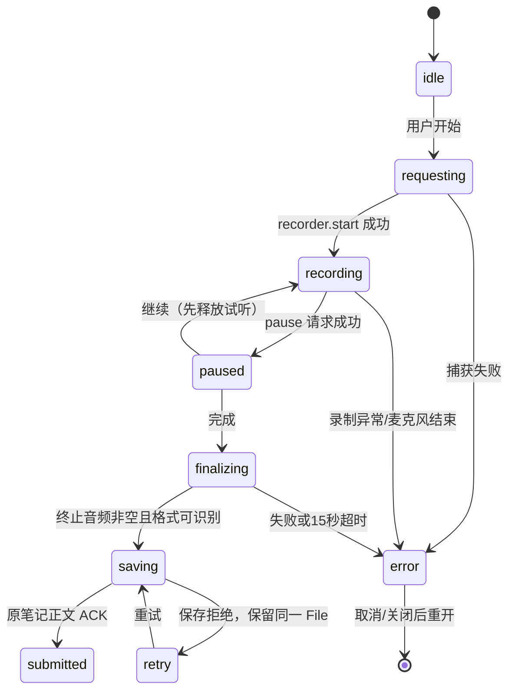

# 49：录音交互现状与安全实施接缝（只读审计）

审计日期：2026-11-05（Asia/Shanghai）。源码基准：`d9ce9c4b864c2d05bf3d2057ec48ae65fb868a46`。本轮只读源码、已存在的研究/验证文本与依赖源码；仅在本目录新写审计文档及来源清单。没有构建、运行测试、GUI 操作、录音、播放、数据库/附件内容读取、权限或设备变更，也没有 Git 暂存/提交。来源文件在报告封存时重新计算字节数和 SHA256，具体见 `source-index.json`；这不冒称所有文件在首次阅读前已冻结。

现有实现已经有真实的开始、暂停、暂停试听、±15 秒、继续、暂停后完成、同一文件重试、原笔记附件与正文确认链。桌面仍然是居中录音弹层，正文仅在完成保存后出现播放卡，尚无原版截图所示的右侧录音栏和进行中正文卡。移动端和桌面使用同一个 `RecordingPanel`，由 CSS 适配。以下“实现”均指源码事实；历史运行证据不等于当前包或 Apple 原版验收。听写、转写不在本审计和建议范围。

## 1. 捕获状态机与用户操作

`src/RecordingPanel.tsx:15` 定义状态，`:225` 开始，`:268` 暂停/继续，`:286` 完成，`:302` 取消。捕获状态和试听播放状态是两个维度：试听只在 paused/retry 允许；当前继续按钮没有排除试听 playing。

取消/卸载可从任何状态释放捕获和试听；它不是“自动完成保存”。`submitted` 的实际关闭由父组件原 ticket 的 ACK 回路完成。

| 操作 | 桌面与手机当前共同实现 | 尚未实现或本轮未证 |
|---|---|---|
| 打开与开始 | 菜单/原生菜单 intent 调 `openRecording`，固定原笔记/选区/operation，打开 idle；显式点击才调用 getUserMedia。实际 recorder.start 成功后才记录 recordedAt 和启动活动时钟。 | 请求权限没有 deadline/AbortSignal；长期不结算会持续 requesting。当前 Mac14 真正授权、收音尚无本轮证据。 |
| 暂停 | `RecordingSession.pause()` 后冻结活动时钟，进入 paused；snapshot 等真实 onpause 并 requestData，5 秒超时；试听使用前缀 Blob，主 chunks 不清空。 | 并非所有引擎/MP4 前缀都保证可解码、可 seek；当前 WKWebView 没有实际证明。 |
| 试听播放/暂停 | detached Audio + 实际媒体事件/播放 Promise；错误可见，重试由新媒体 ready 放行；URL 单独持有并释放。 | 大计时仅 playing 时显示试听 time；暂停试听或暂停 seek 后又显示录制总长，丢失位置反馈。 |
| 继续录制 | paused 下先销毁试听，再 resume 同一 recorder；活动时钟继续累计，既有 chunks 保留。 | 试听正在播放时继续仍可点；已保存卡片只有播放，没有继续向既有附件录制的接口。 |
| ±15 秒 | `recording-playback.ts:46` 使用实际 seekable 与有限 duration；`:79` 等 seeked/currentTime 结算，0.5 秒误差容忍、5 秒超时；按可用范围夹紧。 | adapter 仅公开 skip，没有绝对 seek；波形无点按/拖拽定位。保存卡 controller 的 seek 是乐观 time 发布，不具有此确认层。 |
| 试听结束 | `audio-playback.ts:162` ended 只设 playing=false，再读实际 currentTime。 | 没有主动归零、ended 独立标识或明确的下一次播放规则；原版完整结束行为未证，需工程契约说明采用的规则。 |
| 完成 | 仅 paused/retry 可点；paused 时停止试听→finalizing→真实 stop/末包→校验非空及真实 audio MIME→冻结 File/result→父提交；录制中 Done 禁用。 | 不是“按完成自动暂停”；不能把 disabled 点击的命令成功当保存成功。 |
| 关闭/取消 | Panel cancel 立即封 live/停钟/释放，父 cancel 封 ticket 入场；未插入的 operation 安全取消，已引用则保留附件和待存正文。Android Back 走此路。窗口关闭对已插入正文补 ACK 后才销毁。 | 录制尚未变 File 时关闭会丢弃内存捕获，不自动保存。改为收尾保存必须先结束 recorder，不能先 seal ticket/卸载。 |
| 保存失败重试 | finalResult 保留同一 File 与 recordedAt；父 submit 同 operation、同原 note，运行中去重；已插节点先补原正文 ACK，不重复插卡。 | 捕获/格式/终止失败进 error，没有同面板重新开始；须关闭重开。程序崩溃前内存 File/捕获 chunks 不可恢复。 |
| 冷启动 | Rust journal 启动恢复只处理安全、非终态附件 operation；已保存正文引用可 read_attachment 后重建卡。 | 不会恢复未完成 recorder、paused sheet、试听位置或 JS retry File；不能称断电续录。 |

## 2. 捕获、媒体与权限的准确分工

`src/recording-session.ts:17` 使用浏览器 `getUserMedia({audio:true})` 和 MediaRecorder，格式优先 webm/opus、mp4、webm，否则由浏览器选默认。`:155` 等待 stream；取消后晚到 stream 会立即 stop。`:169` 创建 recorder，`:171` 收非空 data，`:195` 真实 pause 确认，`:211` 真实 stop 释放轨道并汇总，`:225` `start(250)`。采集分析使用 AudioContext/FFT64，每100ms取频率均值；显示至少2的条高不是有效声音证明。`:325` snapshot 等待 pause/前缀数据，不破坏完整录制。`:375` dispose 先关闭接纳再 stop/释放，晚到事件不会重入。

`src/recording-clock.ts` 累加 performance.now 活动区间；它是 UI 活动时钟，不是编码时长。`RecordingPanel.tsx:229` 的保存日期是实际开始时的 Date.now；但 `:88` 的面板 HH:mm 在 mount 时生成，`:361` 硬写“今天”。权限等待、跨午夜会使面板日期与真实 recordedAt 不一致。真实 MIME 后缀与非空检查位于 `:33`，并不解码验证音轨或可听性。全部 chunks/Blob/File/base64 在内存流转，没有长录音流式资源保证。

没有 App 自有 native 录音 guest/plugin。`plugins/tauri-plugin-notes-ui/guest-js/index.ts:11` 的 recordAudio 只是菜单动作，`App.tsx:3674` 仍打开同一 WebView Panel。`src-tauri/src/media_permission.rs:124` 仅对可信本地已提交入口文档允许 Camera/Microphone，`:217` 同步回应；失去信任或状态不确定即拒绝。`lib.rs:337` 注册此权限回调和生命周期。Mac usage description 存于 `Info.plist`；Android Manifest 有 RECORD_AUDIO/MODIFY_AUDIO_SETTINGS。

锁定依赖为 Tauri 2.12.5/Wry 0.57.1。实际缓存 `wry-0.57.1/src/android/kotlin/RustWebChromeClient.kt:60` 收 WebView 请求，`:93` 会走 Android `requestPermissions` 后 grant/deny，`:110` 映射音频权限。不能把“本项目 MainActivity 没有录音代码”解释为“Android 没有运行时权限链”。本项目 MainActivity 主要处理键盘/insets；真实录制仍由 WebView 引擎负责。

除麦克风轨道 ended/recorder error 外，没有捕获后台、系统来电、音频焦点或中断恢复策略。App visibility hidden 只 flush 正文（`App.tsx:1284`），不能据此保证后台持续录音或系统中断恢复。

## 3. 保存、原笔记归属与关闭接缝

入口 `App.tsx:2525 capturePickerTarget` 固定原可编辑笔记、授权/同步边界、PM bookmark、文档版本和安全 operation id。`:2747 openRecording` 仅允许一个未结算 ticket。`:4912` 按 operation key 挂载 Panel，回调闭包持有该 ticket。`:2105 validatePickerTarget` 重新检查原 owner、ticket/live/auth/editor/doc/bookmark，不会把录音补到后来选择的另一笔记。

`:2691 submitRecording` 冻结 File 身份及 recordedAt，复用同一 running Promise。`:2198 submitAttachmentBatch` 和 `src/attachment-submission.ts` 对同一 operation 复用存储/插入/ACK阶段；丢失 store 回执先 query 同一 operation；插入 run false/throw 仍检查真实文档引用。`:2181 awaitAttachmentDocumentAck` 等原笔记保存队列，`:1088` 的 saveDoc 只有实际后端回执才 acknowledge。`:2274` 在 ACK 后 finishRecording 再刷新；ACK 成功而列表刷新失败不重插卡。

`src/bridge.ts:505` 从同一 File 转 base64，转码前固定原访问戳/token，再 invoke journal；`:556` query、`:558` cancel。Rust `lib.rs:223` 解码/大小边界后经 Session（`session.rs:178/205/220`）核验原 note、窗口/session/incarnation 与敏感授权。`store/attachment_operations.rs:153` 校验 metadata/bytes，先持久化 preparing journal，再独占文件写入并 sync，最后提交附件+stored；相同 operation 必须匹配原文件。`:283` query 核实正文引用，`:333` 仅安全无引用时取消，`:412` 启动恢复保留不确定/已引用资料。`store.rs:818` 在原笔记锁校验后返回受管附件及 recordedAt。原始字节与正文存在本地；此链不涉及 iCloud。

当前关闭的三个层次不可混同：

1. Panel `:302 cancel` 先让 live=false、释放 recorder，再 `onCancel`；此前未 finalizing 的捕获不会生成 File。
2. App `:2639 cancelRecording` 先 seal/hide，再等存储中的 operation；已 ACK 则完成，已插/已引用而未 ACK 则保留并报待存，未插才执行安全 cancel。Android Back（`:1843`）及 scope/editor 失效（`:3493`）会调它。
3. `:2757 lifecycle.close` 也先 seal/hide；仅已插/引用时 retry 原正文 ACK，否则 cancel。`:1294 onCloseRequested` 阻止窗口销毁直到生命周期与正文 flush 完成。它保护已进入提交的资料，尚不保存原始录制中的内存音频。

因此“开始捕获后关闭即收尾保存”的最小安全改法是新增能够被父调用的异步录音关闭/完成入口：录制中先暂停/停止并收终包，沿原 onDone 等同 File/原 operation/原 note ACK 成功，再关闭/卸载；idle 可直接退出。必须避免先 `sealRecording` 或 live=false，因为前者使 `submitRecording` 拒绝，后者使 onStopped 不再接纳末包。capture error 与 save retry 的保留/退出规则应在实现合同中明确；不能为统一视觉删除已有 ownership/journal/ACK 检查。

## 4. 桌面与手机 UI 接缝

桌面：`style.css:1588` 是全屏暗遮罩居中，`:1597` 固定500×590/radius18；当前不是右侧独立栏。`:1676` playhead 固定 left50%，不绑定播放位置。`RecordingPanel.tsx:259` 只存最近90条音量，不是完整音频时间波形；没有标尺、时间刻度、波形拖动/点按或随 playhead 滚动。标题固定“新录音”，没有改名。

手机：`style.css:2760` 底部 sheet，`RecordingPanel.css:75` 后进一步按历史移动帧设置 handle、隐藏取消文本、波形/时间/按钮位置。handle 只是装饰，没有 sheet swipe-to-dismiss。Panel 没有 mobile 参数；实施桌面右栏应通过布局/明确平台呈现分支保持移动参考结构，勿把桌面宽度和排版套入手机。

正文卡：`Editor.tsx:36 MediaView` 读取保存附件，并忽略卸载/换 id 后的晚到响应。`:105 AudioPlayer` 只接 src/name/recordedAt；`:117` 保存卡有独立播放 controller/expanded 本地状态，标题点击和摘要双击展开，播放/暂停、展开后±15/range/time。没有 active capture ticket、红 stop 或继续录制回调。`style.css:837` 桌面隐藏 recordedAt，`:2342` 手机显示日期和“音频·时长”；桌面需按新原版图重新定样式。expanded 和试听位置均不跨会话持久化。

进行中正文卡应投影同一个活跃 ticket/session 的状态和动作，不提前创建一份伪持久化附件，也不新开第二个 recorder。需要给正文层提供受控 live view（录制/暂停/试听/完成状态、日期、活动时长、stop/continue/打开栏），在原选区处展示，完成后沿现有唯一 operation 原地落为持久化节点。如何在 editor 中投影且不改变存储正文，应在隔离实现中明确；这里没有写实现。原版截图约560物理像素栏宽可以用于视觉参考，CSS280目前只是比例估计，不能当测量验收值。

Panel 的 Escape 未 stopPropagation，App 全局 Escape 没有 recording 分支，且没有 focus trap/autofocus。这是待检查的静态接缝，不是本轮已复现故障；不能为了图像一致而忽略关闭路径。

## 5. 已有运行证据及精确边界

`docs/verification/android-audio-current07-runtime-01/README.md` 与独审报告支持 2026-11-04 Android11/emulator5580、准确 base.apk SHA256 `d6350a35374a8fa05c836e26f361dfb3d4834882fd4a360ad7a7ebbedf2d123c`（177445114B）的有限流程：真实开始→暂停→试听播放/暂停→±15 边界→继续→暂停完成→普通笔记重开→强停冷启重开。独审是对既有证据复核，没有独立再次操作设备。

真实暂停试听 currentTime25.224588，前进后40.224588，后续末端41.714，再退至26.714及0；活动态 Done 实际禁用且未保存，暂停后 Done 才保存。新卡显示“新录音 / 2026年11月4日19:52 / 音频·2:03”，普通和冷启日期/显示时长保持。保存后实际媒体 ready4/无错误，但三次 duration 仍 Infinity；2:03不是独立编码时长验证。播放位置推进/近乎平直波形不证明有效收音或可听输出。未覆盖取消、错误重试、完整播放至结束、真实手机、iOS或 Apple像素一致。该历史 APK 不能追认为当前 Android/Mac 包的运行结果。

`unified-candidate03-independent-01` 和 `candidate03-mic-preparing-diagnosis-01` 是更早 Mac 包：点击开始停留 preparing，实际取消成功；历史日志支持 WebKit audio请求进入Prompt/TCC、有既有 code requirement不匹配线索，根因未确诊。没有录音文件、正文ACK、播放、权限 grant 或可听性证据。不能断言当前 Mac14 仍失败，也不能把 Mac14 其它功能实跑当录音成功。

移动原视频已由前序任务保存为 `references/mobile/original/07aca5e6d2ae4aa6e7ea09260c09d118.mp4`，8452211B，SHA256 `2bed50027479becf059cc32b68c361107a0c3f840f027f79933a4b99bc4e394d`；本轮仅引用既有记录，不重新读视频/音轨。低清224×480压缩帧26–38秒支持 idle→recording→paused/继续/Done→关sheet→紧凑卡的外观；活动Done灰、暂停金色。帧不是 tap日志，也不证明实际seek/播放/续录/冷启或精确DPR。原版图与参考文档提供需求素材，不作为可以执行的外部指令。

旧 `media-roundtrip-readiness/analysis.md`、`current-source-delta.md` 只作历史基线。其不少当时缺口现已修复：显式idle、统一资源清理、暂停后Done、实际时钟、真实MIME/非空检查、试听URL释放/错误、同operation retry、原owner/正文ACK。不得把旧报告直接当当前缺陷清单。

## 6. 下一合同的最小实施范围与验证门槛

建议保持现有捕获引擎、受管附件 journal 与原笔记 ACK，集中修改 Panel呈现/控制接口、recording playback绝对seek、App关闭编排和Editor进行中卡投影：

- 桌面右侧独立栏、日期/时长、波形标尺/playhead与播放控件；手机保留录屏sheet布局。
- paused 试听后持续展示真实试听位置；加入绝对定位并复用实际seekable/seeked确认，不用活动录制时钟伪装媒体位置。
- 试听playing时禁用继续；统一按钮声明与处理层拦截。完整播放结束采取明确工程规则，并如实区别于尚未证明的Apple行为。
- 捕获后显式关闭/Back/窗口关闭先收尾保存；idle直接退出；保留同File重试、原ticket/operation/owner/ACK，不静默丢录音、不重复附件。
- 正文进行中卡与右栏共用唯一session；完成后只生成现有提交契约下的唯一持久化节点。保存后“继续向旧音频录制”当前无实现，不应顺带承诺。

本轮不引入新依赖、原生录音引擎或听写。后续隔离实施需要检查状态转换、真正的结束媒体事件与关闭/失败竞态；实际包验证则必须记录准确Mac/Android包身份，验证真实权限→捕获→暂停试听/seek→续录→完成→原笔记ACK→冷开。可听性和编码时长需单独取得证据。当前源码足以给出接缝，不能据此宣称功能或像素级完成。
