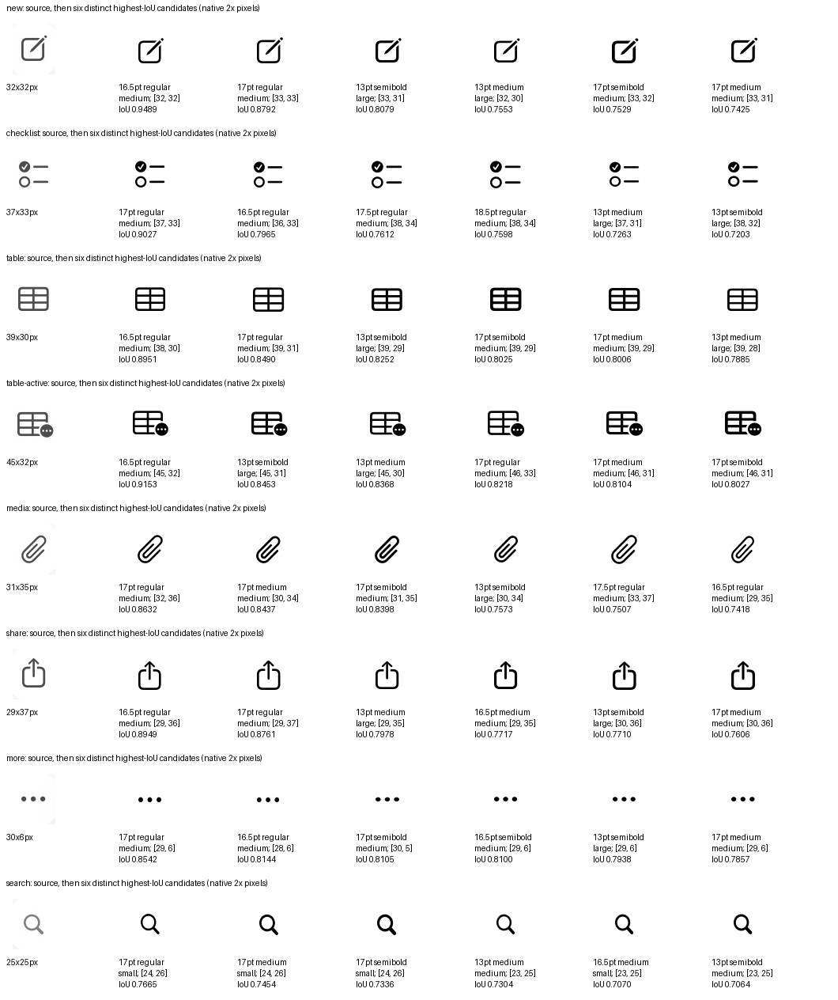
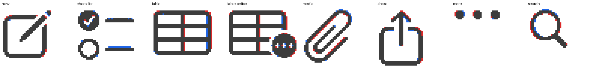

# macOS 原版工具栏符号校准

记录日期：2026-11-03。范围为已保存的原版 macOS 备忘录工具栏截图与当前 Mac 的公开系统符号；本轮只做离屏绘制，没有启动原版、克隆、窗口或工具栏原型，也没有修改应用代码。

## 结论与开发起点

8 个动作的最接近候选均为系统公开符号，字重均为 `regular`。普通工具栏图标可从 `medium` scale、16.5–17pt 开始校准；搜索图标独立使用较小的 `small` scale。普通表格和编辑表格状态分别有 `tablecells`、`tablecells.badge.ellipsis`，不必在普通表格图标上手工拼接徽章。

这些参数是离屏候选搜索的结果，不能确认为苹果备忘录内部使用的参数。原版由系统控件在实际窗口中合成，本轮候选为透明位图；字体栅格化、半像素位置、前景色、抗锯齿及控件绘制路径仍可能产生差异。所有候选均未达到逐像素一致。

| 动作 | 系统符号 | 本次最佳配置 | 原版有效边界 px | 候选有效边界 px | 掩膜 IoU |
|---|---|---|---:|---:|---:|
| 新建 | `square.and.pencil` | 16.5pt regular medium | 32×32 | 32×32 | 0.9489 |
| 清单 | `checklist` | 17pt regular medium | 37×33 | 37×33 | 0.9027 |
| 表格 | `tablecells` | 16.5pt regular medium | 39×30 | 38×30 | 0.8951 |
| 表格编辑 | `tablecells.badge.ellipsis` | 16.5pt regular medium | 45×32 | 45×32 | 0.9153 |
| 附件 | `paperclip` | 17pt regular medium | 31×35 | 32×36 | 0.8632 |
| 分享 | `square.and.arrow.up` | 16.5pt regular medium | 29×37 | 29×36 | 0.8949 |
| 更多 | `ellipsis` | 17pt regular medium | 30×6 | 29×6 | 0.8542 |
| 搜索 | `magnifyingglass` | 17pt regular small | 25×25 | 24×26 | 0.7665 |

上表所有 px 都是 2 倍截图的物理像素，除以 2 才是 pt。有效边界来自二值化图形，既不是按钮点击区域，也不是 `NSImage.size`。必须保留符号自身纵横比和留白，不能将每个图标拉伸到统一方框。搜索的匹配度明显较低，应该在真实搜索控件中单独复核。

## 原始参考与坐标

原图均为 2176×1320px，对应 1088×660pt。第一张截图含格式菜单，第二张为表格编辑状态。本轮只保留工具栏公共区域的紧裁剪；格式按钮附近的指针不在所选图形区域内。

- `references/desktop/macos26-format.png`：新建、清单、普通表格、附件、分享、更多、搜索。
- `references/desktop/macos26-table.png`：表格编辑符号。

下表坐标为原始截图左上角原点。边界采用 `[left, top, right, bottom)`。中心是二值有效边界的几何中心，不能直接当作按钮中心或工具栏排列约束。表格编辑行来自另一种列布局，不能与第一张截图的横坐标混用。

| 动作 | 原图有效边界 px | 图形中心 pt |
|---|---|---|
| 新建 | [1057, 35, 1089, 67) | (536.50, 25.50) |
| 清单 | [1255, 36, 1292, 69) | (636.75, 26.25) |
| 表格 | [1336, 37, 1375, 67) | (677.75, 26.00) |
| 表格编辑，另一布局 | [1406, 37, 1451, 69) | (714.25, 26.50) |
| 附件 | [1414, 35, 1445, 70) | (714.75, 26.25) |
| 分享 | [1523, 32, 1552, 69) | (768.75, 25.25) |
| 更多 | [1611, 49, 1641, 55) | (813.00, 26.00) |
| 搜索 | [1717, 40, 1742, 65) | (864.75, 26.25) |

坐标、完整原图 SHA-256、裁剪矩形、每项符号的最佳位移、原生逻辑尺寸及前六组配置保存在 `assets/macos-symbols/rankings.json`。实际接入时应先对齐相同窗口尺寸、侧栏/列表状态和工具栏分组，再校准图形位置。上表没有给出尚未测量的按钮间距、玻璃轮廓或真实控件中心。

## 取样矩阵与判定规则

运行环境为 macOS 26.4（25E246）、arm64；编译使用 Swift 6.3.3 和 macOS SDK 26.5。渲染由本机 AppKit 完成，不下载字体、符号文件或第三方图标。

每个符号覆盖 12–20pt，步长 0.5pt，`regular / medium / semibold` 三字重及 `small / medium / large` 三比例，共 153 组；8 个符号共 1,224 张候选，全部可用。每张为透明 RGBA、40×40pt、2 倍、80×80px。`NSImage` 按自身逻辑尺寸居中绘制，没有拉伸或后处理缩放。完整矩阵参数保存在 `assets/macos-symbols/sampling.json`。

对比流程：

1. 从原图直接裁剪 54×64px，不重采样。54px 宽度用于避开搜索占位文字。
2. 在每块原图中，以灰度最小值近似前景、灰度中位数近似背景。二值图形条件为灰度 `< round((最小值 + 中位数)/2)`；本次各原图阈值依次为 163、162、162、162、162、164、163、188。搜索原图图形更浅，因此阈值独立计算。
3. 候选使用 alpha `>=128` 的图形掩膜。
4. 只做平移：先以各自有效边界左上角归一化，再穷举 x、y 各 −3 到 +3 物理像素，取最高交并比。不旋转、不缩放、不变形。
5. `IoU = 图形交集像素数 / 图形并集像素数`。它只衡量阈值后的图形形状；忽略前景色、玻璃、按钮、工具栏布局和应用其余区域。**IoU 不是 RGB 像素通过率，也不是全 UI 相似度。**

`rankings.json` 同时记录最佳候选的阈值敏感性：原图阈值 ±15、候选 alpha 阈值 96/128/160，共 9 组。该检查只展示当前候选的分数变化，没有据此重新搜索最佳参数。改变阈值即可改变分数甚至邻近字号的排序，因此 16.5pt 与 17pt 不能仅凭本表作最终判断。

## 可视证据

`ranked-contact-sheet.png` 每行左侧为原版裁剪，后面是六种不同栅格结果的最佳候选，保持原始 2 倍像素。候选纯黑、原版灰色，这是离屏绘制和原版合成色的区别，形状比较已用掩膜排除颜色。



`aligned-mask-differences-4x.png` 为对齐后的二值掩膜，4 倍最近邻放大：深灰为重合，红色为仅原版具有的像素，蓝色为仅候选具有的像素。此图只放大检查，不参与评分。仍可见表格分隔线、附件、分享箭头、搜索圆弧等边缘差异。



`matrix-17pt-*.png` 每张固定在 17pt，按字重和 scale 展开九宫格；这是可检视的尺寸/字重/比例矩阵。`original-*.png` 为无重采样原始裁剪；`candidate-*.png` 为所选最佳透明候选。它们只用于 macOS 研究验证，不是 Android 的打包资源。

## 复现

从仓库根目录运行，依赖本机 AppKit、Xcode Command Line Tools、Python 3 与 Pillow。候选全集、编译产物和模块缓存留在 `/tmp`；仓库只保留参数、指标、原始裁剪、少量候选和对照图。

```sh
xcrun swiftc -module-cache-path /tmp/notes-symbol-cache \
  docs/research/assets/macos-symbols/generate.swift -o /tmp/notes-symbol-generator
/tmp/notes-symbol-generator /tmp/notes-symbol-candidates
python3 docs/research/assets/macos-symbols/compare.py \
  /Users/water/work/2026/Apple-Notes-Clone \
  /tmp/notes-symbol-candidates docs/research/assets/macos-symbols
```

Swift 脚本只调用公开 `NSImage(systemSymbolName:accessibilityDescription:)` 和 `NSImage.SymbolConfiguration`。系统符号随运行时变化；换系统版本后应重新生成并记录环境，不能用此结果保证另一版本的栅格输出。

## 当前未证明的项目

本轮没有测出原版内部符号配置，也未验证真实 `NSButton`/`NSToolbarItem` 的模板着色、默认 symbol configuration、不同缩放屏幕或深色模式。没有测试 Liquid Glass 合成、悬停、按下、禁用态、键盘焦点、工具栏溢出及无障碍行为。上述内容须在原版与克隆的实际窗口中另行验收。

此前 `docs/verification/qa-001/pixels-toolbar/metrics.json` 的原始 RGB 不匹配比例为 0.526893，包含工具栏布局、图标、背景及状态差异；不能与这里的图形 IoU 相减、合并或换算。图标匹配进步也不能替代全工具栏像素验收。
