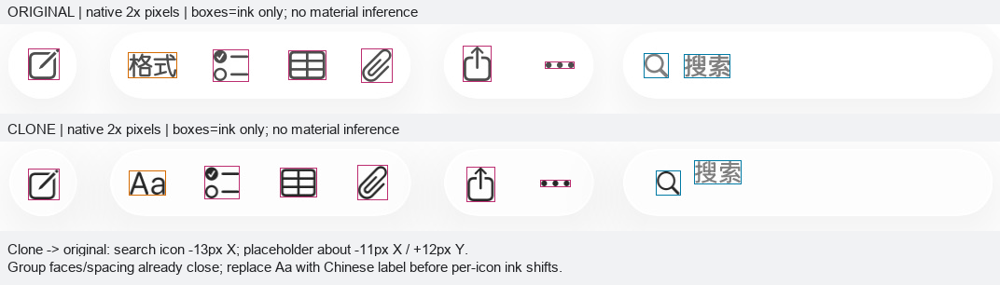

# Mac 正式宿主公共顶部：离线可执行差异

2026-11-03。只读已保存的 `pair-original.png` / `pair-clone.png`、采集前后状态、`roi-metrics.json` 和既有几何研究；没有 GUI、重新采集、构建或产品修改。输入先冻结字节，SHA、9个固定墨迹ROI和175/190/205阈值结果见 `inputs.json`。唯一标注图为 `top-ink-deltas.png`，保留原始2×像素，无缩放或图像配准。

**下一轮优先校准“格式”中文标签、各动作的内部墨迹和搜索内部位置。四个公共组的可见面与18/18/16pt间距已经近似对齐，不宜为内部墨迹差异整体移动胶囊。** 本组仍明确不具备pixel-identical结果。

## 采集条件与结论边界

两张原图均为 **2176×1322px**；采集前后记录中主窗均 **1088×661pt**，2×。既有几何研究的历史参考是2176×1320px/1088×660pt，本轮没有拉伸高度或套用历史全页坐标。顶部使用同一绝对像素坐标，原点左上，矩形半开 `[L,T,R,B)`；2px=1pt。

采集前后Notes和克隆app均 `active=false`，frontmost是Codex；但没有采集中每一瞬间key-window标志。原主窗屏幕位置 `(160,185)`，克隆 `(153,100)`，周围内容和玻璃背景不同。只可描述这对失活图的实际RGB差异，**不能把它严格归因为材质实现、tint或某个blur参数，也不能据此给出调色常量**；active/hover/pressed/disabled颜色匹配仍unknown。

两边合成笔记正文相同，但原版6篇、克隆1篇，侧栏与计数不同。只分析既定公共区域 `[1096,8,2168,104)`（新建、编辑、共享、搜索），不算标题、计数、侧栏、正文、光标或系统共享标记，更不算整页分数。原有roi-metrics的MAE9.1324与changedRatio74.57%仅是这对未配准失活ROI的描述，不是材质因果、真实交互或全页通过指标；本轮没有新增整页评分。

## 公共组可见边界与间距

白面阴影与背景接近，使用已知端帽附近的局部强边缘辅助读界，不把单一“白色阈值”强行套给两图。两边主体可见纵向约 `[16,88)`px，即y8–44pt、36pt高。中心附近y52px的强边缘读数如下，端点通常±1–2px；它是可见面截线，不是AppKit frame或点击框。

| 面 | 原版y52截线px | 克隆y52截线px | 下一轮处理 |
| --- | --- | --- | --- |
| 新建圆面 | `[1105,1178)` | 约`[1106,1179)` | 约1px差在边缘误差内，先保留整组锚点 |
| 编辑胶囊 | `[1214,1536)` | 约`[1214,1537)` | 总宽约161pt，先校内部动作 |
| 共享/更多胶囊 | `[1572,1732)` | 约`[1572,1733)` | 总宽约80pt，先校内部动作 |
| 搜索胶囊 | `[1764,2160)` | `[1764,2160)` | 约198pt宽，右距8pt，保留外组位置 |

对应面间净空原版约36/36/32px（18/18/16pt），克隆按该截线约35/35/31px，均只差1px，误差可累加；历史研究也支持18/18/16pt。当前没有支持“把整组挪4–6pt”的可见边界证据。端帽曲线、阴影、材料透射和精确轮廓仍unknown；52pt仍只是宿主预留参照，不能由白面36pt推出原版NSToolbar frame。

## 墨迹差异与执行量

固定ROI内取中性墨迹 `max(RGB)<190` 且通道差<18；175/205敏感性一并保留，多数边界不变，少数1px变化。表内位移为**克隆墨迹中心移到原版墨迹中心**，正x向右、正y向下。它只指导绘制内容，不能直接转成按钮hit rect或字体基线。文字替换应先做，再复测其位置。

| 内容 | 原版墨迹bbox px | 克隆墨迹bbox px | 克隆→原版中心delta pt | 最小动作 |
| --- | --- | --- | --- | --- |
| 新建 | `[1127,35,1159,67)` | `[1127,38,1159,70)` | `(0,-1.5)` | 图形尺寸近似，内部向上约1.5pt |
| 格式 | `[1234,39,1285,65)` 中文“格式” | `[1235,40,1273,65)` Aa | 不直接沿用Aa位移 | 替换为真实中文标签，目标墨迹约25.5×13pt、中心`(629.75,26)`pt；字重/字体不是本轮证明值 |
| 清单 | `[1325,36,1362,69)` | `[1316,35,1352,69)` | `(+4.75,+0.25)` | 首先横向向右约4.75pt，纵向0.25pt低于稳健精度，先不强调 |
| 表格 | `[1406,37,1445,67)` | `[1397,37,1435,67)` | `(+4.75,0)` | 内部向右约4.75pt；墨迹宽差约0.5pt待复测 |
| 附件 | `[1484,35,1516,70)` | `[1480,34,1511,70)` | `(+2.25,+0.25)` | 内部向右约2.25pt，纵向小量先保留 |
| 共享 | `[1593,32,1622,69)` | `[1597,36,1626,72)` | `(-2,-1.75)` | 内部向左约2pt、向上约1.75pt |
| 更多 | `[1681,49,1711,55)` | `[1676,50,1707,56)` | `(+2.25,-0.5)` | 内部向右约2.25pt，纵向为约1px差 |
| 搜索放大镜 | `[1787,40,1812,65)` | `[1800,40,1825,65)` | `(-6.5,0)` | 放大镜向左6.5pt，纵向已齐 |
| 搜索占位“搜索” | `[1830,41,1878,65)` | `[1841,29,1890,53)` | `(-5.75,+6)` | 文字左移约5.5–5.75pt、下移约6pt；与放大镜不能一起整体上下移动 |

搜索放大镜相对外胶囊左缘：原版11.5pt，克隆18pt。占位字左缘：原版33pt，克隆38.5pt。原版占位与放大镜纵向同处约y20–32.5pt，克隆占位却在y14.5–26.5pt；因此单改search.frame整体y会把已对齐的放大镜带错。占位与图标尺寸已经接近，先改内部排布，不能从墨迹包络反推精确font.lineHeight、baseline或文本输入hit inset。

原版四个编辑墨迹中心x分别1259.5/1343.5/1425.5/1500px；克隆为1254/1334/1416/1495.5px。原版可见墨迹并不满足现有等分槽的相同中心节距；需要中文标签和局部内容位置校准，不能通过一次平移整个编辑组同时对齐四项。

## 下一轮最小源码校准位置（只读建议）

本轮同时冻结了 `plugins/tauri-plugin-notes-ui/macos/toolbar.m` 的当前字节，仅用于指出改动位置；没有额外核实这份源码与截图二进制的逐字节构建关系。以inputs中的SHA定位，后续并行变化须先确认。

1. **格式文案**：`symbolFor`约`:26–31`仍把format映射为textformat；`:139–142`统一image-only按钮，`:197–205`统一解析SF Symbol，`:223`统一设button.image。只对format建立中文标题/标签绘制和样式，保留固定format动作、无firstResponder及既有回调，不用Aa模拟汉字。不能简单把按钮title设“格式”却继续image-only。
2. **内部图标与槽位**：`:240–247` placeGroup按总宽等分动作；`:251`、`:323`负责161pt编辑组与80pt共享组尺寸。先保持这些组的外锚点与间距，校图像/文字的内部绘制位置或动作专属视觉inset；不要用墨迹目标改成未经验证的点击框。新建/共享的纵向差单独处理，不全局移动所有按钮。`:203–204`的16.5/17pt符号尺寸可在局部位置修正后复测，本组不支持全局放大图标。
3. **搜索内部**：`:150–158`的NSSearchField创建、默认cell与占位绘制，以及`:301/:328`内层frame `(10,4,width-20,28)` 是最小排查点。外胶囊已齐；图标和占位要分别校准，保留真实field editor、搜索回调、composition/ack及焦点契约。当前没有可用证据支持把真实输入替换成静态文本或把整个搜索组下移。
4. **材质/前景**：`:224`使用labelColor，而本对失活图的前景深浅确有不同；先保留待证，不据此写死灰度或换glassStyle。需另次匹配活动状态/屏幕背景才能隔离因果，本轮不扩大采集或菜单矩阵。

## Unknown 与交接

本次只支持公共顶部这一状态的差异准备，不证明active/hover/pressed/disabled、hit rect、可访问性frame、焦点/输入法、菜单/弹层、窄窗/溢出、动画或生命周期。材质/阴影/blur/tint、字体真实家族/字重/基线、AppKit内部frame和对齐约束仍unknown。不同计数/侧栏/正文不纳评分。下一轮先完成上表内容校准再在同尺寸、同焦点与可比背景条件下重采公共ROI；没有pixel pass结论。

