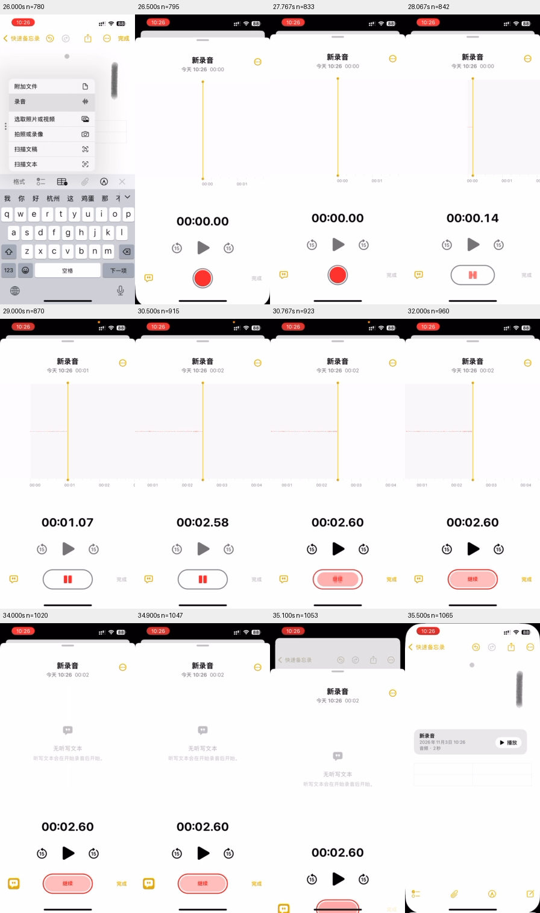
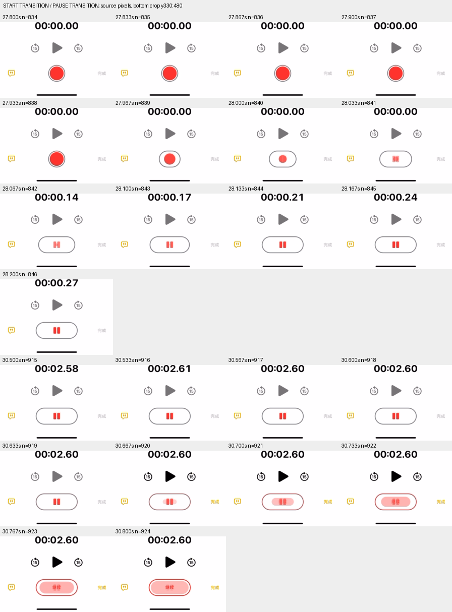
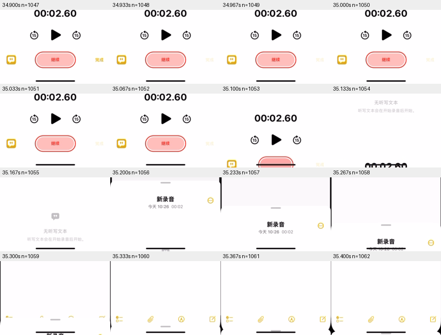
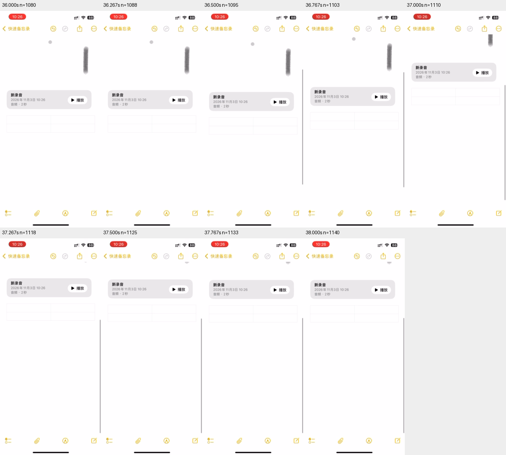

# 原版移动录音面板 · 26–38 秒有限时序补证

日期：2026-11-04。仅分析用户原录屏已经保全的副本 `references/mobile/original/07aca5e6d2ae4aa6e7ea09260c09d118.mp4`。没有操作原版/克隆 GUI、设备、麦克风、产品源码或构建 target；Store 产品冻结仍为 `4d5898f51fa500af4ae3f94ac88b7df86c743fa0`。

**可确认原版存在可见的初始待录制界面，然后进入录制中，再暂停为“继续＋完成”，最后直接收起并出现约 2 秒录音卡。** 初始界面不再是只凭 28 秒一帧猜测：完整控件已经持续显示多帧。录屏没有可识别的按钮触点或输入日志，因此仍不能单独证明触发录制的物理手势、单/双击规则或底层启动时机。这里把可见 UI 状态与触发机制分别记账。

## 输入与取样

原文件 8,452,211B，SHA256 `2bed50027479becf059cc32b68c361107a0c3f840f027f79933a4b99bc4e394d`，224×480、30 fps、视频 stream 3437 帧/114.566667 秒、容器114.583334秒。源画面是有损压缩的小尺寸录屏，无法反推出设备原生点数、DPR、精确色值或系统/Notes build；本报告不作像素一致性验收。

26–36秒按0.25秒目标选最近真实源帧；应 root 的额外有限核对，36–38秒用同样规则看卡片后续动作。30 fps不能表示每个0.25秒：半帧目标取后一个真实帧，最大偏差约0.016667秒。再对开始 n834–846、暂停 n915–924、完成 n1047–1062 三个窄窗口保留逐原帧观察。总共检查83个不同源帧，不插帧/补帧，实际PTS由ffprobe逐帧读取。

`frame-index.json`记录全部源帧零基索引、实际PTS和PNG hash；只保存12张完整代表图、代表拼图、两张转场裁切拼图、36–38秒有限延伸拼图，约1MB以内。未保留的中间单帧可以用 `python3 docs/research/mobile-recording-sequence-01/extract.py` 从原文件重建。原文件 SHA 在重建前后均核对，没有改写或另存转码视频。



## 可见状态与时间线

| 源帧 n / 实际 PTS | 可见控件和计时 | 转场与支持事实 |
| --- | --- | --- |
| 780 / 26.000000s | 正文附件菜单，“录音”行灰色高亮，仍有键盘 | 面板尚未显示；只能确认菜单视觉状态，不能把高亮当作完整输入事件日志。 |
| 788 / 26.266667s | “新录音”面板向上进入，00:00.00、底部红圆、灰色完成已出现 | 明确属于进入动画。 |
| 795 / 26.500000s | “新录音”、00:00.00、底部红圆录制按钮；灰播放/±15、灰完成 | 面板主要控件完整可见，顶部几何仍可能处在最后的进入动画。 |
| 803–838 / 26.766667–27.933333s | 面板几何稳定，00:00.00持续，红圆、灰完成；没有红暂停胶囊 | 支持稳定存在的初始待录制 UI，至少跨1.16秒；不能将进入面板就绘制录制中/暂停按钮当成此录屏原状态。触发机制仍没有输入日志可证。 |
| 839–841 / 27.966667–28.033333s | 红圆伸展成白底描边胶囊，红点收窄为暂停双竖条；计时仍00:00.00 | 开始录制的可见控件变形过程。不是凭28.000s一帧判断初始状态。 |
| 842 / 28.066667s | 00:00.14、红暂停胶囊，完成仍灰 | 第一次密取窗口内可读的非零计时。 |
| 870 / 29.000000s；915 / 30.500000s | 00:01.07→00:02.58，暂停双竖条、灰完成 | 计时实际可见递增，时间轴跟随移动。这里只证明 UI 计时，不证明有效/可听音轨。 |
| 916–920 / 30.533333–30.666667s | 计时先见00:02.61，再稳定00:02.60；播放/±15由灰变黑，完成变金，底部暂停开始变形 | 暂停边界，存在动画及显示值稳定过程；不能由瞬间显示差异反推出录音文件精确时长或计时算法。 |
| 923–960 / 30.766667–32.000000s | 红“继续”胶囊、金“完成”、黑播放和±15，计时00:02.60固定 | 32秒状态确实是暂停，可继续也可完成。 |
| 968–1005 / 32.266667–33.500000s | 同一暂停控件和00:02.60，时间轴仍在 | 没有恢复录制或先变成另一个stop界面。 |
| 1013–1047 / 33.766667–34.900000s | 转写图标呈选中态；主体“无听写文本 / 听写文本会在开始录音后开始。”；底部仍“继续＋完成”、00:02.60 | 暂停状态可切换转写视图；空态文字本身不证明从未录音，也不证明有可听声音。 |
| 1048–1052 / 34.933333–35.066667s | “完成”字样变淡，仍可见“继续”和00:02.60 | 与按下/提交转场一致，但未捕获实际触点，不将其写成已观察的tap事件。 |
| 1053–1062 / 35.100000–35.400000s | 同一面板向下收起，录音中/stop新界面没有出现 | 逐帧支持从暂停界面直接进入关闭动画；内部stop/编码/保存步骤无法由屏幕观察。 |
| 1065 / 35.500000s；1080 / 36.000000s | 正文中灰圆角“新录音”卡，日期、`音频 · 2秒`，右侧白胶囊 `▶ 播放` | 可见插入完成的卡片；不证明文件字节、正文持久ACK、冷启或音轨有效。 |
| 1088–1140 / 36.266667–38.000000s | 卡片同上；正文纵向移动，右侧滚动条出现 | 只有滚动/惯性位移，没有观察到卡片展开、进入播放器面板、range或±15。不能推断卡片的单击/双击或展开规则。到38秒停止分析。 |

初始00:00.00阶段与后续录制计时阶段有独立控件差别。可见序列支持以下 UI 状态顺序，不为箭头杜撰物理触发：

```text
附件菜单
  → 新录音初始：00:00.00 / 红圆录制 / 灰完成
  → 录制中：递增计时 / 红暂停 / 灰完成
  → 暂停：00:02.60 / 红继续 / 黑播放与±15 / 金完成
  → 暂停时转写空态（底部状态不变）
  → 面板向下关闭
  → 正文录音卡：音频·2秒 / 播放
```

## 逐帧转场依据

下图上段为开始边界，下段为暂停边界；只裁原224×480图的y330–480，未缩放原像素。时间和 n 是后加标注，不是原版 UI。



下图完成边界覆盖每个真实源帧。暂停“继续”持续到面板开始移出；没有出现要求用户先进入另一个stop页面的可见步骤。



## 对后续实现可用的结论与保留项

- 初始面板的00:00.00、红圆录制、灰完成是已观察状态；不能继续把“所有初始 UI 均 unknown”作为忽略这套控件的理由。该序列与等待用户开始录制一致，且与“进入后立即表现为持续录制中”不一致；按钮触点、物理输入来源及底层是否预先准备麦克风仍unknown。
- 暂停态直接提供并使用完成出口的可见时序已经充分支持任务设计：不需要先要求用户切换到另一个stop界面。实现仍必须实际结束MediaRecorder并等最后数据，不能用截图替代资源/编码收尾契约。
- 原版在录制中完成是灰色、暂停后为金色；暂停时播放、±15可见，继续是底部红色胶囊。要区分这些状态与动画，不把00:00.00当作唯一状态开关。
- 本段没有“继续后再次录制”、录音回放推进、拖动、真实±15、权限弹窗、错误/重试、保存ACK或重启证据。36–38秒只有带播放按钮的卡片和正文滚动，移动展开/单双击行为仍unknown。
- 卡片“2秒”与面板最终2.60只是可见格式，不说明精确文件时长、舍入算法或音轨可听。压缩画面里的近乎平直波形不能推断真实音量/静音；底层媒体数据没有在本任务中分析。


