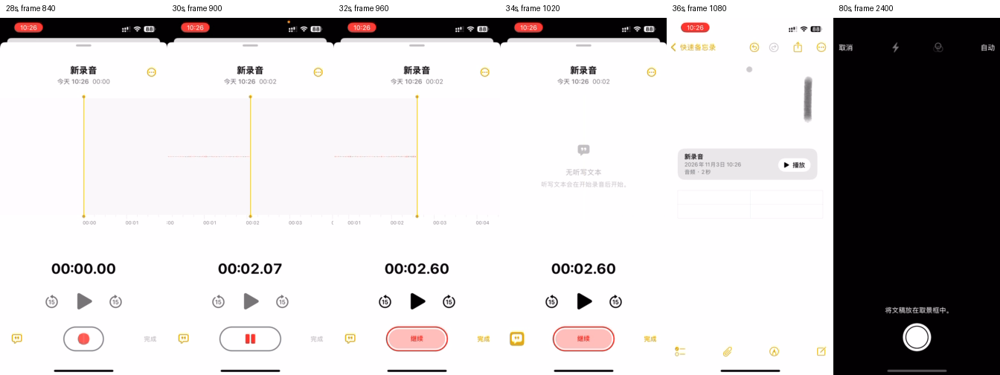
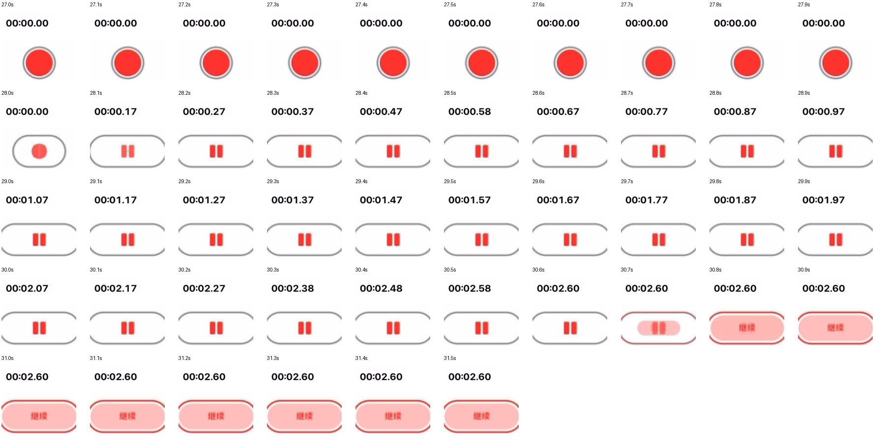

# F09 / F16 离线媒体、中文 OCR 与文稿扫描接入研究

日期：2026-11-03。当前目标为本机 macOS 26.4 的备忘录 4.13，以及 Android 上重建录屏中的手机体验。本轮只读现有源码、缓存、SDK 和原始录屏，查询公开官方资料，执行了一次无窗口的 Vision 语言能力查询；没有修改生产代码、Gradle/Manifest、权限、依赖或系统设置，没有安装包，也没有使用相机、麦克风或 GUI。

## 建议的最小真实路线

- **Android 扫描文本**：自有 Tauri 原生插件 → CameraX 相机页/所选本地图 → bundled 中文 ML Kit → 识别结果确认 → 插入目标笔记选区，所有识别在设备上执行。使用 `com.google.mlkit:text-recognition-chinese:16.0.1` 是本次官方集成文档列出的随包路线；不要误换成 `com.google.android.gms:play-services-mlkit-text-recognition-chinese` 的下载模型路线。官方文档明确区分两者，前者构建时包含模型、可立即使用。[Google 官方集成说明](https://developers.google.com/ml-kit/vision/text-recognition/v2/android)
- **Android 扫描文稿**：自有原生扫描页 → CameraX 预览/拍摄 → 本地四边形检测与手动四角调整 → 透视校正 → 多页复核/排序/删除/重拍 → 本地页面包与 PDF → Rust 附件和文档节点。CameraX 负责取图，裁边算法、页管理和仿原版 UI 由本项目实现；HTML file input 拍照不能替代这条链路。
- **Mac OCR**：对实际导入的本地图片/PDF 页面使用 Vision `VNRecognizeTextRequest` 的 `.accurate` 模式。Mac 原版当前采样中“拍照/扫描文稿/速绘”为禁用项；保留同样条件，不把 Mac 内置摄像头扫描器包装成已复刻原版的入口。ImageCaptureCore 只能作为有扫描仪时的独立设备路线研究。
- **录音**：先独立验证当前 WebView `getUserMedia → MediaRecorder → Rust 附件 → 冷启动播放`。代码和 Wry 已有运行时权限链，不能仅因 MainActivity 没有手写权限申请就判定失败。若实际平台链不稳定，再将采集替换为 Android `MediaRecorder` / Mac `AVAudioRecorder`，保持同一 UI 和本地附件契约。

这是实现建议，不是功能已完成或像素已通过的声明。未执行的集成、离线首次运行、中文准确率和硬件行为仍为 unknown。

## 当前代码与录屏事实

本次读取的源码提交和各文件 SHA 保存在 `assets/offline-media-scanning/local-evidence.json`；后续并行开发可能继续改变行号。

| 位置 | 已观察到的真实代码 | 仍缺的链路 |
|---|---|---|
| `src/App.tsx` 的媒体菜单/扫描弹窗 | “拍照或录像”与“扫描文稿”都点击 `capture="environment"` 的图片 input；扫描文稿显示未实现自动裁边提示；扫描文本显示未接 OCR | 没有文稿边界、透视校正、多页或识别结果 |
| `RecordingPanel` | 进入后请求麦克风并自动开始；选浏览器支持 MIME；真实 MediaRecorder、暂停/继续、结束后 blob、AudioContext 波形 | 原版开始触发方式未证，不能据此判自动开始为已知差异；本轮读取版本暂停后仍须另行结束才可完成，与原版暂停可完成不同；平台采集、时长、音轨及权限需要实证 |
| `src/Editor.tsx` 的 AudioPlayer | 从 Rust 读取真实附件并播放，展开后有进度和前后 15 秒 | 冷启动有声播放、设备路由、暂停/拖动和时长边界须独立验证 |
| `src/bridge.ts`、`src-tauri/src/lib.rs` | 文件整体转 base64，通过 `store_attachment` 传入 Rust | 多页大图不宜继续往返整包 base64；尚无扫描 session/原生 token 导入 |
| `Store::store_attachment` | 校验笔记存在及锁定状态，附件最大 100MB，生成本地 UUID 文件名，写入附件表 | 扫描页集合、原图/变换参数、OCR 和 PDF 的一致提交未建模 |
| Android MainActivity / Manifest | MainActivity 为系统栏 inset 处理；Manifest 声明 CAMERA、RECORD_AUDIO、硬件 optional；minSdk26、compile/target36 | 没有专用扫描 Activity、原生录音或 OCR 插件 |
| macOS Info.plist | 已有 NSCameraUsageDescription / NSMicrophoneUsageDescription | 真正打包权限、签名后的 entitlement 与用户拒绝路径尚须验证 |

从保全的 MP4 按解码帧号抽取 28/30/32/34/36/80 秒，无缩放。源 SHA 为 `2bed50027479becf059cc32b68c361107a0c3f840f027f79933a4b99bc4e394d`，224×480px、30fps；采样参数见 `mobile-sampling.json`。



- 28s：录音面板显示 00:00.00、底部红色图形、播放与前后 15 秒。此帧处于按钮形变过渡，不能单凭零计时或低清图形判定“等待开始”；自动/手动开始未证。
- 30s：计时 00:02.07，可见暂停控制。32s：计时 00:02.60，底部变成“继续”，右下“完成”可用。34s：相同时长，转写区域显示没有文本。36s：回到笔记，出现约 2 秒的音频卡片。
- 80s：黑色扫描相机，取消、闪光、滤镜、自动、快门及放置文稿提示。该帧未展示成品页面，不能据此确认自动裁边、多页、OCR 或 PDF 已执行。录屏也没有提供可用于测准确率的实际中文扫描样本。

原版入口和当前相机 input 的行为差距应保留在 F16 验收中，不能以选择图片成功代替扫描成功。

### 录音开始状态勘误复核

后续对 27.0–31.5s 按每3个解码帧（0.1s）密取46帧，原始全画面无缩放；另将计时原尺寸裁剪、底部按钮以最近邻放大2倍。参数、裁剪坐标和结论保存在 `recording-start-review.json`，由 `review-recording-start.py` 复现。

可确证的显示序列为：27.0–27.9s 的采样帧均是 00:00.00 和大实心红圆；28.0s 仍是 00:00.00，底部控件正在由圆形变宽；28.1s 已是 00:00.17 和清晰的红色双竖条，之后计时连续增加至30.5s。30.6s 起采样计时保持在00:02.60，经过按钮动画后出现“继续”，右侧“完成”高亮。32s 暂停态的结论得到前后序列支持。

本段没有可判定的触点标记。它证明界面经历零计时/圆形、递增计时/双竖条、暂停/继续状态，**不能证明开始录制由用户点击还是自动/延迟开始触发**，也没有精确量出转场时长。此前将28s称为“待录制”并据此断定原版进入面板不自动开始，属于证据不足的推测，现予以撤回；不得将“必须主动点开始”写成已确证的原版约束。当前程序暂停不能直接完成等有独立证据的差异保留。



完整46帧见 `assets/offline-media-scanning/recording-start-27-31.5-contact.png`。原视频224px宽且有压缩，放大不增加原始细节；28s单帧尤其不能替代连续序列或触点证据。

## Android 中文识别：模型随包

官方文档列出 bundled 中文依赖 `com.google.mlkit:text-recognition-chinese:16.0.1`，使用 `TextRecognition.getClient(ChineseTextRecognizerOptions.Builder().build())`；图像可来自 Bitmap、`media.Image` 或本地文件。CameraX 帧需要传递 rotation；识别完成后释放 ImageProxy，不能过早关闭它。中文模型的随包体积会增加，官方文档给出每脚本、每架构约 4MB 的估算；真实 APK 增量以实际构建为准。[Google 官方文字识别](https://developers.google.com/ml-kit/vision/text-recognition/v2/android)

当前指南 Before you begin 写 API23+，页面摘要另出现 API21+；本项目 minSdk26 同时满足，实施时以所锁定 artifact 的实际 Manifest/编译结果为准。本轮没有下载 AAR、检查它的传递依赖或运行识别；这里的版本是本次指南列出的版本，不声称已核验 Maven 中全部更新。

“模型随包”也不等于已经验证所有无 Google Play services 设备的兼容性。应在新安装、从未缓存模型的目标设备上实测；若支持无 GMS 发行环境，将其作为独立设备矩阵，不能从官方集成页推出本项目 APK 已在该环境通过。

建议首次真实接入先做一张受控中文图片的静态识别，再接相机连续帧。识别返回完整文本、块/行/元素边界和失败状态；按已旋正图像统一坐标，在用户确认后插入。对空结果、低对比、运动模糊、旋转、繁简混排分别验收；不承诺识别结果或版面与 Apple 模型相同。扫描文本插入纯文本，文稿扫描保存图像页面和 OCR 元数据；它们应是两个独立结果类型。

## Android 文稿：CameraX、自有 UI、裁边与多页

Google 的现成 `play-services-mlkit-document-scanner:16.0.0` 明确动态下载模型、扫描逻辑和 UI，首次可能等待；它还依赖 Google Play services。即使下载后能本地处理，也不能证明首次离线可用，而且其预设 UI 不能保证与录屏相同，因此不选作本项目基础路径。[Google 官方文稿扫描器说明](https://developers.google.com/ml-kit/vision/doc-scanner/android)

CameraX 官方稳定表在本次查询显示 **1.6.2**（2026-08-26 发布），代码示例却展示 1.7.0-rc01。建议实施时统一锁定稳定 1.6.2 的 `camera-camera2 / camera-lifecycle / camera-view`，由 camera-camera2 引入 core，按需显式 core；本轮未解析依赖、编译或验证它与现有 Java/Kotlin 配置的兼容性。[CameraX 官方版本表](https://developer.android.com/jetpack/androidx/releases/camera)

最小链路按以下顺序实现：

1. 插件确认相机运行时权限，再启动应用自有非导出扫描 Activity。原生页面按录屏设计，真实 PreviewView 位于拍摄 UI 下方；取消返回当前笔记，不更改已保存内容。
2. `Preview + ImageCapture` 绑定 Activity lifecycle；拍摄保存原始 JPEG 到应用私有暂存目录。需要实时边框时再加低分辨率 ImageAnalysis，使用 keep-only-latest 和有界单任务处理，及时关闭 ImageProxy。保留 EXIF / rotation，统一预览、检测与高分辨率原图的坐标变换。[CameraX 拍摄](https://developer.android.com/media/camera/camerax/take-photo)、[图像分析](https://developer.android.com/media/camera/camerax/analyze)
3. 本地检测文稿四边形。可选随包 OpenCV：边缘/轮廓 → 四点多边形与凸性/面积筛选 → 连续帧稳定性 → 自动捕获；失败时真实显示手动四角调整，不能返回虚构边界。该算法是本项目工程方案，尚无本地实现或准确率证据。
4. 对原始图的四个点求透视变换并输出校正图。OpenCV 提供 `getPerspectiveTransform` 与 `warpPerspective`；原图、点序、方向和变换参数一起保留，便于再次裁切。[OpenCV 官方几何变换](https://docs.opencv.org/4.13.0/da/d54/group__imgproc__transform.html)
5. 页面队列允许继续拍摄、重拍、旋转、重新裁边、删除和改序。确认后生成本地多页 PDF/页面预览；Android 平台 PdfDocument 可用于逐页绘制写出，但可搜索文字层、压缩和 PDF 无障碍不是该最小图像 PDF 路线自动提供的能力。[Android PdfDocument](https://developer.android.com/reference/android/graphics/pdf/PdfDocument)
6. 仅点击完成时提交扫描集合；取消丢弃暂存。若杀进程，启动时恢复草稿或清理过期暂存，不能留下已显示卡片但文件不完整的笔记。

OpenCV 官方 Android 指南支持 Maven AAR 和本地 `OpenCVLoader.initLocal()`，可以随应用装载本地库；不要采用旧 OpenCV Manager 下载流程。指南中的 Maven 示例是 4.9.0，不代表本轮已确认 4.13.0 artifact 的 ABI/页对齐/最小 SDK 和体积。版本及 ABI、许可证、16KB 页兼容和 APK 增量均需在正式集成时锁定并实测；本轮没有安装 OpenCV。[OpenCV 官方 Android 指南](https://docs.opencv.org/4.13.0/d5/df8/tutorial_dev_with_OCV_on_Android.html)

若希望避免新增原生图像库，可实现自己的边缘/四边形检测与平台图形透视变换；这减少依赖但增加验证工作，不能省略检测质量和透视校正。本研究优先建议 CameraX + bundled 中文 ML Kit + 随包 OpenCV 的独立原生插件原型，先验证一页，再补多页和自动捕获。

## Tauri 插件与本地数据交接

现有锁定依赖为 Tauri2.12.5、Wry0.57.1、tauri-plugin-dialog2.8.4。实际本地源码显示 Kotlin 插件为 `@TauriPlugin`、方法使用 `@Command`；Activity 返回使用 `startActivityForResult` / `@ActivityCallback`。Rust 有 `register_android_plugin` 和 `run_mobile_plugin_async`；权限可以按相机/麦克风别名请求。不要照搬旧版本 `@PluginMethod` 示例。[Tauri 官方移动插件开发](https://v2.tauri.app/develop/plugins/develop-mobile/)

实现时同时声明插件命令/事件的 Tauri capability；现有 `default.json` 只有 core 与 dialog 权限，不会自动授权新增媒体插件。Tauri 命令授权与 Android CAMERA/RECORD_AUDIO 运行时权限分别处理，不能彼此替代。

建议在受版本控制的独立插件目录实现 Kotlin/Android 逻辑，使用插件 Gradle/Manifest；不要仅把依赖写入可重新生成的 `gen/android` 然后期待永远保留。App 的 MainActivity 继续承载壳，扫描页采用 Activity result。Mac 用条件编译的 Rust API 连接 Vision/AVFAudio，可选择直接 Objective-C 桥或小型 Swift/C ABI；当前 Cargo 尚无直接 Vision/AVFAudio 桥。

以下是拟定契约，不是现有 API：

| 调用/结果 | 必需数据及语义 |
|---|---|
| `begin_scan(mode)` | mode 为 document/text；生成 sessionId，记住 noteId、revision 和插入选区；同时最多一项相机任务 |
| `ScanDraftPage` | pageId、原图 token、校正图 token、原图尺寸、四角归一坐标、rotation、顺序、OCR 状态/文本/坐标 |
| `finish_scan(sessionId)` | 返回有序页面、PDF token 和 OCR 元数据；取消与识别失败显式区分，不以空成功混淆 |
| Rust 导入与保存 | token 只能指向该 session 的应用私有暂存文件；校验目标笔记仍存在/可写、大小、路径、文件类型和操作 revision；提交附件及文档节点后再清暂存 |
| OCR 插入 | 用户确认后插入最初目标选区；期间切笔记或目标删除/锁定时返回明确冲突，不插入当前碰巧打开的另一篇笔记 |

原生层将 `content://` 经 ContentResolver 读取并复制到应用暂存目录；Rust 不将 URI 当文件路径读取，也不让前端传任意绝对路径导入。多页结果传 token 和元数据，不将所有图像 base64 往返 WebView。保存页面原图及变换参数、派生 PDF 和识别文本，区分未识别/识别空结果/失败，给附件浏览和后续搜索保留真实类型。现有通用附件 kind=file 不足以表达扫描集合。

## Mac Vision、外设扫描与连续互通的边界

本机 SDK26.5 的 `VNRecognizeTextRequest.h` 支持 `.accurate / .fast`、语言列表、自动语言检测及语言纠错。运行于 macOS26.4 的只读查询结果已保存：默认 revision3 的 **accurate** 列出 `zh-Hans / zh-Hant / yue-Hans / yue-Hant`；**fast** 只列出六种欧洲语言，未列中文。必须在目标机器按 recognitionLevel/revision 查询语言，不能对中文默认走 fast。脚本没有执行 OCR，因此该结果只证明语言能力列表。

项目 macOS 最低版本为 12.0，而 revision3 在 macOS13+ 才可用。实施时应按系统可用性选择 revision，并对较旧系统查询 accurate 支持列表，不能把 26.4 的列表推广到 12.0。官方 Vision 文字识别摘要说明处理在设备上执行；本轮网页正文未取得，API 细节由本地官方 SDK 头交叉确认，首次实际离线中文识别仍待测试。[Apple Vision 文字识别](https://developer.apple.com/documentation/vision/recognizing-text-in-images)、[VNRecognizeTextRequest](https://developer.apple.com/documentation/vision/vnrecognizetextrequest)

本地图片路径经 ImageIO 解码/方向规范化 → VNImageRequestHandler → accurate 文字请求 → VNRecognizedTextObservation 候选和框 → 用户确认插入，是可先实现的 Mac 最小路线。若以后确需本地文稿裁边，SDK 的 `VNDetectRectanglesRequest` 返回矩形候选、CoreImage `CIPerspectiveCorrection` 执行四角校正；两者不自动提供拍摄 UI、多页编辑或成品 PDF。本轮没有完成该原型。

ImageCaptureCore 的 `ICScannerDevice` 是扫描仪设备；本地头显示 `requestScan`、每页 `didScanToURL`、自动送纸器回调等。Quartz/ImageKit 的 `IKScannerDeviceView` 为 Image Capture 支持的扫描仪提供 UI。这条路径需要实际扫描仪及驱动/授权，不能视作 Mac 内置摄像头的手机扫描器，也不能当作连续互通相机的替代。[Apple ImageCaptureCore](https://developer.apple.com/documentation/imagecapturecore)、[ICScannerDevice](https://developer.apple.com/documentation/imagecapturecore/icscannerdevice)

本机原版已有“扫描文稿”不可用的证据，Mac 克隆应反映同样可用条件。iPhone/iPad 连续互通扫描是另一设备参与的系统流程；本轮未验证可公开调用的完整接入、设备发现或回传。在线 Mac 手册搜索会返回 mac/27，而当前基准是26.4，故不采用27手册推导当前行为，也不增加 Apple 账户/附近设备作为基础离线功能依赖。

## F09 麦克风、录制与本地播放

现有 Rust `on_permission_request` 仅对可信 localhost/tauri.localhost 的 Camera/Microphone 返回 Allow。锁定的 Wry0.57.1 Android `RustWebChromeClient.kt` 进一步将摄像头映射到 CAMERA，将音频映射到 RECORD_AUDIO/MODIFY_AUDIO_SETTINGS，经 `activity.requestPermissions` 完成系统授权后才 grant WebView。Manifest 声明和 Rust Allow 不是完整验收；也不能误说这套依赖没有请求 Android 运行时权限。

Android 原生采集备选：确认 RECORD_AUDIO → MediaRecorder 指定 MIC、MPEG_4/AAC、本地暂存文件 → prepare/start → pause/resume → stop/release → 检查实际音轨/非零时长 → Rust 导入。当前 minSdk26 覆盖 pause/resume 的平台基础。波形必须来自真实采集幅度，播放和 ±15秒由实际媒体时间驱动；非常短的无有效样本录制应处理 stop 错误，不生成虚假卡片。官方录音指南要求运行时权限，并提示后台麦克风有限制；最小版可在退后台时暂停/结束并清楚恢复，不增加本轮未要求的后台服务。[Android 录音指南](https://developer.android.com/media/platform/mediarecorder)、[MediaRecorder API](https://developer.android.com/reference/android/media/MediaRecorder)

Mac 原生采集备选：AVCaptureDevice 查询/申请 audio 权限 → AVAudioRecorder 写本地 AAC/m4a → record/pause/record/stop → 校验媒体 → Rust 附件；SDK 同时提供 currentTime 和 metering。Info.plist 的用途说明已存在；是否授权、拒绝后重试、输入设备缺失、签名/沙盒/强化运行时下资源 entitlement 仍须在实际 .app 验证。强化运行时的音频输入 entitlement 与系统用户授权是两层条件，不能仅添加用途字符串后宣称完成。[Apple 媒体授权](https://developer.apple.com/documentation/bundleresources/requesting-authorization-for-media-capture-on-macos)、[Audio Input entitlement](https://developer.apple.com/documentation/bundleresources/entitlements/com.apple.security.device.audio-input)、[AVAudioRecorder](https://developer.apple.com/documentation/avfaudio/avaudiorecorder)

录音 UI 至少区分权限/采集准备、零计时、正在录制、暂停、预览播放、保存中、失败；这里不预设原版零计时状态由手动还是自动开始触发。暂停时应支持继续和完成，完成先结束真实媒体并等候成功落盘，再插入卡片；取消释放采集并清理草稿。计时须由媒体/单调时间累计，暂停不累计，不能只依赖界面 setInterval。保存后冷启动播放应有实际声音、正确时长、暂停、拖动和前后15秒，不以 HTML audio 元素出现作为通过。转写是独立 ASR 能力，本研究没有选型或验证离线语音模型；OCR 库不能提供录音转写，“无文本”不能伪装为已转写。

## 离线与功能验收的最小样本

1. Android 全新安装后，首次启动前断网；不依赖旧模型缓存。识别固定中文图片，再在真机拍摄相同图片，确认不出现模型下载等待；保存准确率、耗时、APK/ABI 和系统版本。静态图片用来隔离 OCR 与相机问题。
2. 两张真实纸页：不同方向/轻微透视；自动检测和手动调整均实际改变校正结果；可排序、删除、重拍；完成后杀进程重启，页面顺序、图片、PDF 和 OCR 元数据仍一致。取消不增加笔记节点或永久附件。
3. Mac 断网执行受控简繁中文图片识别；按实际系统版本验证 language/revision，标明不支持语言/空结果。扫描仪或连续互通只在实际设备可用时单独验证，当前不作为 pass。
4. 两端录一段含已知口令的真实音轨，暂停/继续/完成；冷启动可听到口令且暂停段不延长录制时间，±15秒/拖动不越界；拒绝权限和设备缺失均不产生卡片。当前模拟器不能替代真机麦克风验收，静音轨不证明录音成功。

## 本轮来源及未获得的正文

| 来源 | 本轮实际获得的证据 |
|---|---|
| Google ML Kit 文字识别集成页 | 获得正文，含 bundled/unbundled、中文依赖、创建 recognizer、InputImage 和旋转说明 |
| Google ML Kit document-scanner 页 | 获得正文，明确动态下载模型/逻辑/UI；不作为纯离线首次启动方案 |
| Android CameraX 版本表/拍摄/分析、MediaRecorder、PdfDocument | 获得官方页面正文；未下载 artifact，未运行其示例 |
| Tauri 官方移动插件页 | 获得正文；注册 API 与 Activity/权限调用另外由锁定本地 Tauri/Dialog/Wry 源码验证 |
| OpenCV 官方 Android 及几何变换页 | 获得正文；未下载 AAR、未检验 ABI 或实际装载 |
| Apple VNRecognizeTextRequest、媒体授权页 | HTML 返回仅 JavaScript 提示；点击 View Markdown 后工具报 unsupported text/markdown。用本地 SDK 头和官方检索摘要作有限证据，不声称看到了正文 |
| Apple Markdown 的本地 HTTP 回退 | curl 受现有 127.0.0.1:7890 代理不可达阻挡；未改代理/网络配置，未继续重复请求 |
| Apple ImageCaptureCore、AVAudioRecorder、entitlement | 官方检索摘要 + 对应本地 SDK 头；没有完整验证硬件或签名行为 |
| iOS26 Notes 扫描手册 | 明确请求26版本，首次返回页面导航，继续正文请求收到429；本研究未用它补全录屏没有显示的操作。未使用搜索返回的27版手册作为26.4基准 |

已检查 `/Users/water/.gradle/caches/modules-2/files-2.1`：未发现 com.google.mlkit、androidx.camera、org.opencv 模块或 GMS 的 mlkit 模块。Android36 的 android.jar 已存在，但对应 Java sources 目录未见 MediaRecorder.java；本轮没有借此安装 sources 或解析 Gradle 依赖。Apple SDK 位于 `/Library/Developer/CommandLineTools/SDKs/MacOSX26.5.sdk`，读取 Vision、CoreImage、AVFoundation/AVFAudio、ImageCaptureCore、Quartz/ImageKit 的官方头文件。

Vision 能力查询可复现：

```sh
xcrun swiftc -module-cache-path /tmp/notes-media-research/module-cache \
  docs/research/assets/offline-media-scanning/vision-capabilities.swift \
  -o /tmp/notes-media-research/vision-capabilities
/tmp/notes-media-research/vision-capabilities
```

输出保存为 `assets/offline-media-scanning/vision-capabilities.json`。查询不创建窗口、不请求权限、不处理图像；不能将它作为 OCR 准确率或实际离线识别通过证据。

手机采样由 `assets/offline-media-scanning/sample-mobile.py` 复现，依赖现有 ffmpeg/Pillow；它使用解码帧号选择，不修改原始 MP4。
