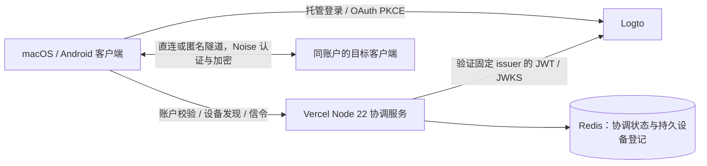

# 服务器开发与运维入口

2026-11-18 正在将账户运行链迁移至 CyberBus：[迁移契约](../architecture/cyberbus-migration-20261118.md)、[Logto/EasyTier 实时调查](../plan/analysis/cyberbus-logto-deployment-20261118.md)。下文 Vercel/Redis/coordinator 是旧客户端运维资料；新链使用 Logto Custom JWT 与 EasyTier，不继续依赖这些账户 API。实际切换与测试状态以迁移计划和新验证报告为准。

更新：2026-11-15。本文依据已提交源码和部署回执整理，本轮没有查询云平台、读取生产环境值或重新部署。后续操作从[部署与排障手册](DEPLOYMENT.md)开始；接口精确字段以源码及链接的契约为准。

## 服务分工

| 组件 | 职责与数据边界 | 源码入口 |
| --- | --- | --- |
| Logto | 用户、托管登录注册、OAuth token、应用与权限；密码仅进入 Logto | [原生固定配置](../../src-tauri/src/account/config.rs)、[认证库](../../crates/account-auth/README.md) |
| CyberNote / CyberGrid 服务 | 验证账户、签发 enrollment、设备目录、会话与信令、静态控制台；不保存笔记正文和附件 | [服务包](../../services/coordinator/README.md)、[账户装配](../../services/coordinator/src/account-config.ts) |
| Redis | 通用协调会话／租约／限流／信令，以及独立的持久设备登记 | [Redis 适配](../../services/coordinator/src/redis.ts)、[Lua 原子操作](../../services/coordinator/src/redis-script.ts) |
| 客户端与匿名隧道 | 客户端之间交换正文和附件；SDK 尝试直连及匿名隧道路线，客户端持有本地数据库和授权 | [账户 transport](../../src-tauri/src/account/transport.rs)、[隧道 provider](../../src-tauri/src/account/provider.rs) |

Vercel 是 HTTP 协调服务，不是承载笔记流量的 WebSocket 中转机。匿名隧道由客户端内置 provider 启动，当前随包包含 macOS / Android 的 cloudflared 资源；域名通常为动态 `*.trycloudflare.com`。服务校验并发布允许的入口元数据，不持有该客户端隧道进程。[端点策略](../../services/coordinator/src/endpoints.ts)内置 quick-tunnel 规则；其他 provider 必须显式配置，不应为连通性问题放开任意 URL。

## 当前固定地址与身份

这些值承担不同职责，不能相互替换：

| 项目 | 当前源码约定 | 变更影响 |
| --- | --- | --- |
| 客户端 HTTP transport | `https://cybernote-sync.aixgg.com`，桌面与 Android 相同 | 固定编译输入，改客户端后需要重建；旧包不会自动更新 |
| Enrollment JWT issuer | `https://cybernote-sync.vercel.app` | 客户端严格验证；服务端使用 `CYBERGRID_PUBLIC_ORIGIN` 签发，没有独立 enrollment-issuer 环境变量 |
| Logto issuer | `https://auth.x.aixgg.com/oidc` | OAuth/OIDC 与资源 JWT 的可信身份来源 |
| Logto API resource | `https://cybernote.app/api`，用户 scope `connect` | 是 audience 标识，不要求该 URL 本身提供 API |
| Native client | [config.rs 的 `CLIENT_ID`](../../src-tauri/src/account/config.rs) | 服务静态策略须允许该 ID；canonical product 自身也是 Native client，别名解析到 canonical product |
| Console SPA client | 服务 `LOGTO_BROWSER_CLIENT_ID`，须在静态产品策略中 | 仅控制台使用，不能获取 Native account profile |
| macOS OAuth 回跳 | `http://127.0.0.1:17897/callback` | 在 Logto Native 应用中精确登记；不是协调服务监听端口 |
| Android OAuth 回跳 | `com.local.notesclone.auth://callback` | 在 Logto Native 应用中精确登记 |
| Console 回跳 | 默认 `CYBERGRID_PUBLIC_ORIGIN` + `/console/callback/` | 与客户端回跳分开；显式覆盖必须是同源专用 HTTPS 路径 |

给服务添加 transport 别名时，保留现有 signing issuer。直接将生产 `CYBERGRID_PUBLIC_ORIGIN` 改成新 transport 域名，会令已有客户端拒绝 enrollment。自托管或身份迁移需要同时设计服务、Logto 和客户端固定输入，不能只改 DNS。别名下完整 Console 登录也须单独验证，匿名 API 可达不证明回跳流程正常。

## 最近归档的生产部署

以下是 **2026-11-14 的最后归档观察**，不是本轮实时状态：

| 项目 | 记录 |
| --- | --- |
| Vercel 项目 | `cybernote-sync` |
| Project ID | `prj_GxQsPabn6tJgX57KyIATAX5DmX7N` |
| Team / scope ID | `team_2ljUqxKg8oifxof0IT3yayWz` |
| 归档团队路径 slug | `yywater68-1778s-projects`，来自当时 deployment URL；操作前在控制台确认当前归属 |
| Production deployment | `dpl_8Fewyd8o8HHUouDYJDULDd6XSweY`，记录时 READY、aliasAssigned |
| 归档 deployment URL | `https://cybernote-sync-4ged87wpy-yywater68-1778s-projects.vercel.app`，用于回溯，不取代正式域名 |
| 精确服务源码 | `e220111362084d4c72b6d6fe2dada505b97a6df3` |
| 已绑定域 | `cybernote-sync.vercel.app`、`cybernote-sync.aixgg.com` |
| 部署方式 | 仓库根目录 Vercel Function + Node 22，源码闭包上传，无环境 override |
| 源码闭包 | 87 文件、385,518 字节；后续版本应重新计算，不能沿用此数量作为通过条件 |

[完整部署回执](../verification/account110/server/registry-deployment01/README.md)及[独立复核](../verification/account110/server/registry-deployment-review01.md)记录双域匿名边界、部署 ID 和精确输入。首次打包遗漏 `api/package.json`，虽显示 READY 但 API 为 500；补齐后才恢复。READY 不能替代 HTTP 烟测。

自定义域名的[DNS 执行记录](../verification/account109/server/custom-domain-live02/README.md)保存了 CNAME 和独立验证 TXT，当时为 DNS only。它们是历史供应商分配值；重绑域名时从现有项目重新取得要求，不照抄旧验证记录覆盖其他业务记录。

生产 Redis 密码、主机和实际 namespace 值、签名私钥、workspace seed、平台登录 token 不写入本文。已归档部署未读取这些环境值；其当前值、Redis 所在区域、持久化／备份策略和告警负责人应在有权限的平台控制台与团队密钥管理中确认，不能从烟测推断。

## 开发时从哪里修改

服务 vendored 上游为 CyberGrid Node server `0.2.0`，冻结源 revision `f2a3961536e5c69b13c7dbc661953d9243becbae`；项目的账户与设备登记是附加实现。修改保留 [LICENSE](../../services/coordinator/LICENSE) 和 [npm notices](../../services/coordinator/notices/README.md)，依赖使用服务自己的 `package-lock.json`。

| 修改内容 | 入口与验证位置 |
| --- | --- |
| 新账户 API / Native 产品验证 | `src/account-config.ts`、`account-profile.ts`、`identity.ts`、`products.ts`；`test/account-profile.test.ts`、`identity.test.ts`、`products*.test.ts` |
| Enrollment 签名／JWKS | `src/account-enrollment.ts`；`test/account-enrollment.test.ts` |
| 持久设备目录 | `src/notes-devices.ts`、`redis.ts`、`redis-script.ts`、`memory.ts`；[精确 API 契约](../../services/coordinator/notes-devices.md)、`test/notes-devices.test.ts` |
| 通用设备发现／会话／信令 | `src/service.ts`、`directory-snapshot.ts`、`admission.ts`；`test/api.test.ts`、`directory*.test.ts`、`admission.test.ts` |
| Node 与 Vercel 路由／可信 IP | `src/main.ts`、`node-server.ts`、`function.ts`、`function-client-ip.ts`；`test/node.test.ts`、`function-client-ip.test.ts` |
| 页面与构建 | `public/`、`release/build*.mjs`；`test/console*.test.ts`、`npm run build:vercel` |

表内短路径均相对 `services/coordinator/`。`memory.ts` 是 fixture 实现，不应替代生产 Redis。账户入口必须走 `createAccountCoordinator`；只装配通用 coordinator 会遗漏账户和持久登记路由。

## API 与权限速查

| 路由 | 身份／作用 |
| --- | --- |
| `GET` / `HEAD /healthz` | 匿名；服务和 Redis readiness。GET 正常正文 `ok\n`，不验证 Logto、隧道或正文同步 |
| `GET /api/v1/auth/config?appId=…` | 匿名读取被允许 Native 的公开认证与端点策略配置 |
| `GET /api/v1/console/auth/config` | Console 的公开配置，独立 SPA 流程 |
| `POST /api/v1/auth/exchange` | 验证 Logto 资源 access token，取得 SDK 设备会话；按[通用服务实现](../../services/coordinator/src/service.ts)处理 |
| `GET /api/v1/account/profile` | Native 资源 access-token Bearer；无查询／请求体，返回可信账户与派生 workspace |
| `POST /api/v1/account/enrollment` | 同类 Native Bearer；绑定设备 UUID 与 Noise 公钥，签发五分钟配对凭证 |
| `GET /api/v1/account/jwks` | 匿名读取 enrollment 公钥，无私钥 |
| `GET /api/v1/notes/devices`、`PUT /api/v1/notes/devices/self` | Native 资源 access-token Bearer；持久设备列表／本机发布，精确字段见登记契约 |
| `/api/v1/devices`、`/api/v1/directory`、`/api/v1/devices/self`、`/api/v1/signals` | SDK 设备会话授权的临时目录、发布与信令；不能拿它重建已过期的持久设备记录 |

资源 access token、SDK session key、enrollment JWT、设备 registry key 各有独立用途，不可混用。协调服务不接收账号密码；旧 `/auth/register`、`/auth/login` 返回 410。在线／连接／成功应用数据是三个不同状态；持久目录元数据不授予内容访问权，仍要验证 enrollment 及 Noise。

## 继续开发的验收边界

最近桌面验证见[account110 结果](../verification/account110/RESULT-LATEST.md)：两客户端发现及单次 Push / Pull / Both 已有实际数据验证；开启许可和刷新不会自动广播。旧 fresh-run `NATIVE_TIMEOUT` 原因未确定，保留失败记录。Android／4G 强制匿名中转及生产 Redis 备份恢复没有在本轮交接中验收。

每次服务发布保留源码 revision、输入清单／hash、deployment ID、公开配置与 JWK 指纹对照、烟测结果和回滚目标。只归档有限状态与脱敏证据，不提交原始平台响应、token、用户内容或本地 `.env`。

本次交接的[静态独立复核](../verification/account110/server-handoff01.md)已通过；不构成新的线上部署或功能验收。
