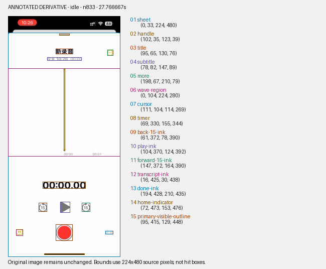
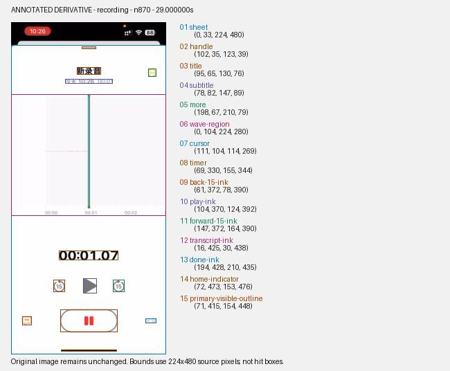
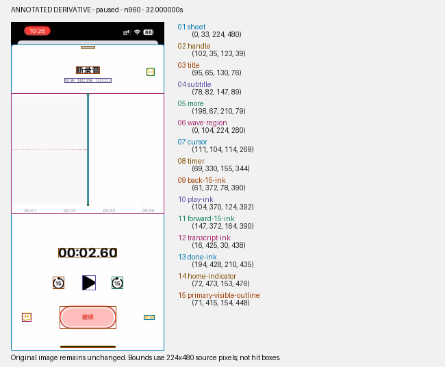

# 移动录音面板：已证三态的局部布局

## 60 游标与时间轴标签校准依据（2026-11-05）

继续59同原比例、同暂停态校准，原Android现场保持不动。根据[只读测量60](../research/mobile-recording-wave60-readiness/README.md)，原n0960黄色游标半开墨迹[111,104,114,268]，59为[111,104,114,252]；原首个完整00:01标签阈值220为[20,273,36,278]，59为[20,260,33,264]。原有损边缘约±1–2视频px，不用一个阈值推定精确字体。

完整wave框约y104.07..269.01已经接近目标。保持其top15.9%/height36.9%、52.8%底边，以及59 notice/retry top56%、计时与播放控制位置。只手机校准内部黄色游标下缘、axis位置与label字号/padding/line-height，使游标接近268、标签墨迹接近273..278。现bottom30逻辑px截短约17.14视频px；bottom约2、label约11逻辑px可作为待渲染候选，参数以真实图像与窄高可用性选择。不得为追游标直接增加完整wave高度，也不把这些候选冒称原生token。

```text
同原比例224×480投影（非实际设备点数）
wave top104 ── 黄色游标 ── 目标下缘268
wave完整框底269（保持）
            时间轴标签目标墨迹273..278
            axis包含文字溢出的完整有效边界
notice/retry top约283（保持，窄高余量更小）
```

axis框、刻度、label行框及墨迹含溢出均不得侵入notice/retry；必须同时测392×840、320×568、280×600，而非只在参考比例调一张图。axis视觉装饰区域不应抢占下方提示滚动/重试触达；不得缩小44px重试区或移动59已校准控制行。若需让axis脱离wave框显示标签，应显式限制完整有效边界并检验溢出，不靠overflow:hidden裁掉文字获得不重叠结论。保持真实waveform slider原框、100px/s、pointer capture/触摸seek及媒体确认规则。原图样本不能推断振幅缩放，60默认不改sample区/实际样本映射；如需变动须先指出证据依赖。

60最终手机局部参数：playhead bottom2px；axis height20px/bottom−18px，标签font11px/line-height13px/padding-top6px。axis顶部与游标底部同为完整wave底缘上方2px，标签实际19px行框完整容纳于20px轴框，轴框仅裁掉超出视口的横向时间带，不裁文字上下缘；wave overflow允许该明确的下方装饰，axis pointer-events:none，不把溢出区变成额外seek区域。samples原底部30px预留和样本映射保持。

视口高≤650px时，只将axis改为height17px/bottom−15px、标签padding-top3px，字号与line-height保持11px/13px，完整16px标签行框容纳于17px轴框。实测392×840轴底488.77/提示顶495.80、320×568轴底333.31/提示顶335.25、280×600轴底351.25/提示顶354.14逻辑px，分别留7.03/1.94/2.89px；包括全部刻度和文字Range的有效边界。此短屏留白是无原版同尺寸参考的工程约束，不称原生token或错误态像素一致；计时、播放、提示/重试和真实slider框不移动。

仅录音手机局部CSS，不改桌面同props图像、DOM和computed style；不改会话/owner、权限、保存ACK、RecordingView动作或原生。受控实际共享View可用于样式和动作验证，不能宣称已验手机收音或整个产品像素一致。仍保留无听写和真实错误内容。

## 59 播放行校准依据（2026-11-05）

用户选择保留当前 Android 录音现场并暂缓手机设备验收。本项只进行源码及受控共享视图校准，不操作、备份或安装原设备。以下基于原暂停帧 n0960 和准确源码 `8a30547514588d1ba6f35eb3c9d2564eb1ee637d` 的 58 投影：392×840 逻辑尺寸、DPR2 渲染为784×1680，再整幅等比例缩至224×480；横纵换算均为1.75逻辑像素／视频像素，面板顶边均y33。

以下仅此表采用**闭区间**墨迹包络，阈值 `max(R,G,B)<96`，不能与下文半开区间误混：

| 元素 | 原 n0960 | 58投影 | 校准目标 |
| --- | --- | --- | --- |
| 大计时 `00:02.60` | `[70,330,154,343]`，85×14 | `[70,331,153,345]`，84×15 | 保持宽约84–86视频px；先手机限定黑色/字重候选，必要上移1–2px |
| 后退15 | `[61,373,77,389]`，中心(69,381) | `[60,378,76,396]`，中心(68,387) | 播放行上移6–7视频px，横向位置保留 |
| 播放三角 | `[104,370,122,391]`，19×22 | `[108,382,116,393]`，9×12 | 仅中央图形放大/校形，可见目标约35×38.5逻辑px；不放大整行按钮 |
| 前进15 | `[147,373,162,389]`，中心(154.5,381) | `[147,378,163,396]`，中心(155,387) | 同行上移，横向位置保留 |

播放行 `top:75.4%` 可先试73.7%–73.9%，保持原8%行高、44px触控区域及横向布局。三角阈值160时原20×22、新11×12，约1.82倍线性差异；按最终可见墨迹验收，不能拿SVG外框替代。左右skip已略大，不能随中央图形放大。计时深色像素原473/新370，阈值160时589/522；跨阈值支持偏轻判断，压缩和缩放不能证明唯一font-weight。先测试手机限定黑色和600/650/700候选，不先改字号或全局字体。

保持100px/s共享时间轴、原有状态/动作/会话及桌面全部几何。初始、采集中、暂停、播放中保持原真实可用性；新图形不得改变点击区域或伪造播放成功。桌面同props图像/DOM应不变。此项不移动整个sheet，不处理既有黄色游标底部高度、系统区域、转写排除项或未知省略菜单，也不据此宣称整体像素通过。

59窄高回归实测：320×568受控新图中旧notice `top:71%` 的矩形y414.59/h21.16与已上移的播放按钮y429.41/h44重叠6.34逻辑px，也与计时框y383.92/h36重叠5.33px。69.7%上移候选进一步侵入计时，不采用。已测空带为波形末端y318.31至计时顶缘y383.92；原重试按钮位于y335.25/h44。允许仅手机把notice移到原56%重试空带：无重试保留4%可滚动提示高度；有重试时提示居左、最多44px可滚动高，重试居右保留44px触达及top56%，左右互不相交。必要视图标记只加在手机投影，不改变状态，避免依赖旧手机WebView不支持的`:has`选择器。必须实际核波形、计时、提示、重试和播放互不相交。此为有错误时的工程可用性修正，不改变原版普通态目标或冒称已证原版错误排布。桌面同props的DOM/布局/样式及普通图像应不变；深色图如只有可复验的极少1通道栅格差，保留首次和后续图并量化，不能擅改桌面或冒称字节相同。

任务57保存边界：手机录音完成后，可信同步返回仍须等待原 SearchEditorHost 的门控恢复布局实际提交，再重取原目标快照并执行全部 note/owner/editor/scope、正文、版本与授权检查。同步临时冻结不作为目标已改变的证据；不删除 isEditable/available 检查。首次存储前及存储后第二次校验一致，取消/封会话/卸载结束等待；真实目标或正文/权限变化仍失败并保留同 File/operation，真实正文 ACK 前不关闭。此为修复既有保存流程的工程边界，不改变录屏布局及桌面会话规则。

状态：参考规格，2026-11-04。仅使用已经保全的 224×480 代表原帧，不新增取帧或扩大时段。目标是为局部状态任务提供布局依据；不是高清像素验收，也不表示当前克隆已具有下列行为。

来源：[26–38 秒逐帧时序](../research/mobile-recording-sequence-01/README.md)、[初始 n833](../research/mobile-recording-sequence-01/representative/frame-n0833.png)、[录制 n870](../research/mobile-recording-sequence-01/representative/frame-n0870.png)、[暂停 n960](../research/mobile-recording-sequence-01/representative/frame-n0960.png)。实际 PTS 分别 27.766667、29.000000、32.000000 秒。原录屏/原图保持原字节，本次未操作 GUI、设备、target、产品或主 Git。

## 总体结构

面板覆盖到屏幕底部；顶部保留系统状态区和后层页面的浅灰唇边。三态面板位置不动，计时/播放/底部操作保持相同区域，仅中央操作形态、计时与控件启用外观变化。

```text
原始画面 224 × 480；坐标原点左上
x=0                  x≈112                 x=224
┌──────────────────────────────────────────────┐ y=0
│ 系统状态区（非本组件；未反推安全区点数）       │
│       后层灰唇边约 y=27–33                   │
╭──────────────────────────────────────────────╮ y≈33 面板顶边
│                   ━ 把手                    │ y=35–39
│                  新录音               ⊙⋯    │ y=65–79
│              今天 10:26 00:00                │ y=82–89
│                      ●                      │ y≈104
│                      │ 黄色当前位置线        │
│        波形/时间带    │                      │ y≈108–266
│                      ●                      │ y≈269
│               00:00       00:01              │ y≈273–278
│                                              │
│                  00:00.00                    │ y=330–344
│                                              │
│             ↶15      ▶      15↷              │ y≈370–392
│                                              │
│   转写图标      [中央录音动作]         完成    │ y≈415–448
│                                              │
│                系统 Home 指示条               │ y=473–476
╰──────────────────────────────────────────────╯ y=480
```

标题上方没有另一行导航栏标题；原帧中未见当前克隆的“取消”文字。顶部右侧为带圆圈的省略图形；本段没有打开它的证据。图中“转写图标”等是区域说明，原帧此处没有对应文字标签。这三个原帧中未见当前克隆的“正在录音/已暂停/录音已完成”等副标题；本规格不为错误/权限流程发明原版提示样式。

## 坐标与测量边界

以下统一使用 **`[x0,y0,x1,y1)`**，右/下端不包含。归一化为 `(x0/224,y0/480,x1/224,y1/480)`，基于整张视频画面。表中是已压缩图的可见墨迹/轮廓近似包络，边缘约 ±1–2 原视频像素不确定；不是原生控件 frame、CSS 尺寸、可点击范围或安全区。没有可见边框的波形区仅记区域包络，不冒充隐藏容器实测。

| 区域/可见元素 | 原视频像素 bounds | 归一化 bounds | 说明 |
| --- | --- | --- | --- |
| 面板主体包络 | `[0,33,224,480)` | `(0,.0688,1,1)` | 中部水平顶边约 y33，圆角处逐渐进入，到 x0 边缘约 y40；不能用此推原生圆角半径。后层 y27–33 不计入面板。 |
| 把手 | `[102,35,123,39)` | `(.4554,.0729,.5491,.0813)` | 约 21×4；灰色，水平居中。 |
| 标题“新录音” | `[95,65,130,76)` | `(.4241,.1354,.5804,.1583)` | 三态同位置，约 35×11 墨迹。 |
| 日期/时长小行 | `[78,82,147,89)` | `(.3482,.1708,.6562,.1854)` | 初始/暂停包络；录制 n870 右端约146。不是大计时。 |
| 顶部圆圈省略图形 | `[198,67,210,79)` | `(.8839,.1396,.9375,.1646)` | 金色外观；点击/菜单未知。 |
| 波形与下方轴标签包络 | `[0,104,224,280)` | `(0,.2167,1,.5833)` | 波形主要内容约 y108–266，轴小字约 y273–278。 |
| 黄色当前位置线及端点 | `[111,104,114,269)` | `(.4955,.2167,.5089,.5604)` | 视觉主轴 x≈112，三态位置相同；不是可拖动手势证据。 |
| 大计时数字 | `[69,330,155,344)` | `(.3080,.6875,.6920,.7167)` | 三态约 86×14 墨迹，水平居中；使用等宽数字外观。 |
| 后退15图形 | `[61,372,78,390)` | `(.2723,.7750,.3482,.8125)` | 初始/录制为灰，暂停为黑；三态位置相同。 |
| 播放三角图形 | `[104,370,124,392)` | `(.4643,.7708,.5536,.8167)` | 三角尖使可见包络中心略向右，不据此把逻辑按钮中心移右。 |
| 前进15图形 | `[147,372,164,390)` | `(.6562,.7750,.7321,.8125)` | 与后退形成对称操作行。 |
| 左下转写图形 | `[16,425,30,438)` | `(.0714,.8854,.1339,.9125)` | 已见图形；首个局部状态任务不填无功能按钮。 |
| “完成”字样主墨迹 | `[194,428,210,435)` | `(.8661,.8917,.9375,.9062)` | 各帧边缘有压缩色晕，暂停可见包络可扩至 y426–436；主对齐不变。 |
| Home 指示条（系统） | `[72,473,153,476)` | `(.3214,.9854,.6830,.9917)` | 不是组件需要自行绘制的控件。 |

以面板内坐标测量时，可用 `sheetY=(y−33)/447`。这是同一参考图上的换算，不是另一项原生测量。开发布局应优先保留居中轴与行之间的空间关系，不把 224 视频宽度直接当作 224 CSS px。

## 三态中央控件与实际字样

| 状态 / 代表帧 | 中央可见外轮廓 | 归一化 bounds | 同一状态的文字与可见变化 |
| --- | --- | --- | --- |
| 初始 / n833 | `[95,415,129,448)`，约34×33圆形外轮廓；红色内圆主色区域约`[100,418,126,445)` | `(.4241,.8646,.5759,.9333)` | 标题“新录音”；小行“今天 10:26 00:00”；大计时`00:00.00`；完成灰；播放/±15灰。红圆周围有浅间隔和灰外圈，不是整块红胶囊。 |
| 录制 / n870 | `[71,415,154,448)`，约83×33胶囊；白内底/灰外轮廓；红暂停双竖条`[106,425,119,438)` | `(.3170,.8646,.6875,.9333)` | 小行“今天 10:26 00:01”；大计时`00:01.07`；完成仍灰；播放/±15仍灰。底部没有独立 StopCircle。 |
| 暂停 / n960 | `[71,415,154,448)`，同尺寸胶囊；红轮廓/浅红内底；“继续”主墨迹`[104,427,120,435)` | `(.3170,.8646,.6875,.9333)` | 小行“今天 10:26 00:02”；大计时`00:02.60`保持；中央文字“继续”；完成金色；播放/±15黑。 |

中央控件中心约 `(112.5,431.5)`，与大计时逻辑中心 x≈112 对齐；初始圆与后两态胶囊共用纵向位置。录像支持两者之间存在控件变形，但本规格不新增抽帧或估算弹簧参数/精确动画曲线。不能用宽度突变的某一转场帧代替稳定态目标。

计时显示两位小数已可见，但原版计时实现、刷新频率与编码时长舍入未知。新实现可采用实际活动区间的单调累计，暂停冻结、继续接续；这是工程实现方式，不能据 UI 读数填充媒体 metadata。时间戳“今天 10:26”是该录音实例的可见文本，不应硬编码为产品内容。

## 输入与状态约束

| 区域/输入 | 录屏支持 | 局部状态任务边界 |
| --- | --- | --- |
| 进入面板 | 初始红圆/00:00.00稳定出现多帧，然后才变录制态 | 必须存在可区分的初始、录制中、暂停外观。录屏没有触点日志，不能宣称已证明单次 tap/自动触发。若实现选择点击红圆开始，任务须明确它是实现选择。 |
| 录制中暂停 | 递增计时转固定计时，暂停控件变“继续”，完成灰→金 | UI 按真实采集状态推进，不只根据计时是否为零决定。 |
| 暂停继续 | 按钮可见文字“继续” | 本段没有真实继续后的序列；可以实现已有语义，必须独立验证资源/计时，不能写成视频已验证。 |
| 暂停完成 | 同一暂停面板直接下收，后出现音频卡 | 不强迫用户先进入独立 stop 界面；内部仍须真实 stop 并等末块/onstop。保存成功必须等父正文 ACK，属于另项接线，不由这个布局规格证明。 |
| 取消/Back、权限/错误/忙碌 | 本段没有明确触点、权限或失败 UI | 保持工程清理/活性契约，错误应真实可见；不把当前克隆某种文案或样式冒称原版。 |
| 文字输入/焦点 | 面板内没有文字输入框 | 不主动给正文落光标或唤起 IME；原版精确焦点/键盘转场仍需运行证据。 |

## 窄屏与实现接缝

本参考只有一种画面比例，不能推断横屏、分屏、动态字体、非零安全区或原生设备点数。面板以容器宽度居中，共享 x≈50% 中轴；大计时、播放行和中央底部控件不得因状态切换上下跳动。实际 Android 视口应使用真实宿主安全区，禁止自己绘制录屏中的系统状态栏/Home 条；所有触摸区域可大于可见墨迹，具体无障碍/触摸尺寸属于实现要求，不能从这些小图“测得”。

```text
App（当前挂载/父目标与保存归属）
  └─ RecordingPanel（纯抽取后独立组件；onCancel / onDone(File) Promise）
       ├─ header：标题 / 实例日期时长 / 顶部动作
       ├─ waveform：真实采集样本 + 时间带
       ├─ elapsed：单一固定区域的大计时
       └─ primary：idle圆 / recording暂停 / paused继续
            └─ paused Done → 真实收尾 → 父保存调用
```

真实接缝与局部/父保存先后关系见 [下一步差距分析](../research/mobile-recording-next-01/analysis.md)。布局文件不修改 App、RecordingSession、CSS 或新 store 协议，也不将纯抽取通过计为状态修复通过。

## 尚未实现或未验收的可见区域

- 暂停中的真实回放/±15、时间轴 seek：图形及启用外观可见，操作效果不在本段证据；不能放看似可用的空按钮代替真实功能。
- 转写图标、选中态及“无听写文本 / 听写文本会在开始录音后开始。”空态：另有 n1020 等已保全帧，但不是首个局部状态任务要伪造的转写能力。
- 顶部省略菜单、其他录音命名/管理操作：本段未展开。
- 精确材料、阴影、字形、字号、颜色数值、曲线和动画：源视频 DPR/缩放过程/高清系统字体/Notes build 未知。只使用“红、灰、金、黑”等可见关系，不从有损单像素反推设计 token，不标像素pass。
- 有效/可听音轨、正文 ACK、重启恢复、Mac 原版录音布局：不由本文件验收。

## 标注图与原图保全

以下均为**坐标标注衍生图，不是原版截图**。左侧是原224×480图的拷贝加框，右侧为坐标图例；未缩放左侧源像素。上文原图链接保留无标注输入。[bounds.json](recording-mobile-assets/bounds.json) 记录三张原图 SHA、PTS、标注图 SHA、所有 bounds 与归一化值。色框颜色仅为阅读辅助，不是产品颜色。







后续真实暂停回放接线见 [app-002-recording-preview-01](../plan/tasks/app-002-recording-preview-01.md)。该任务不改变本文件原帧事实，尚不代表已实现或设备通过。
