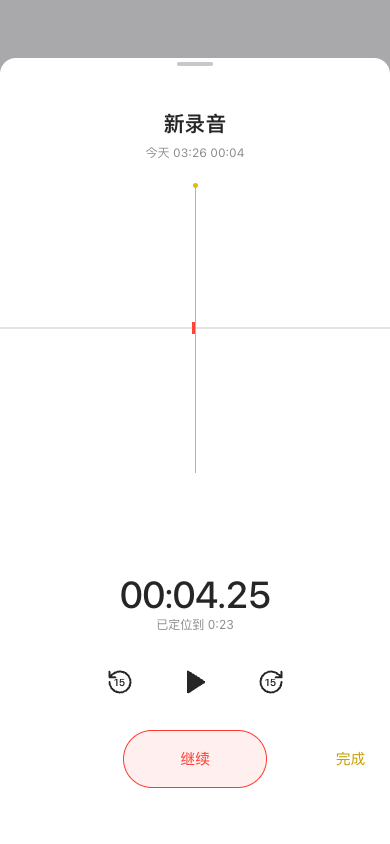
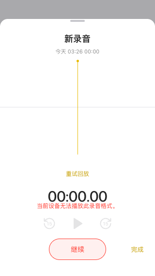

# 暂停录音回放候选 01

2026-11-04，开发自检冻结，等待独立审查。基线 `48120ab2aa4831f03fcb04cf5478e666a1b09492`，独立分支 `task/app-002-recording-preview`，工作树 `/private/tmp/apple-notes-recording-preview-01`。本候选进入下一安装包；没有加入或重建 candidate03。

## 实现与边界

`RecordingSession.snapshot()` 等待本次实际 pause 事件，串行 requestData，复制截至响应数据事件的累计实际 chunks 与 recorder MIME。快照请求去重，5 秒无数据响应明确失败；空快照、requestData 失败不关闭主采集。继续、完成、取消或采集失败使旧请求失效，已发请求的占位保留到数据事件排空。快照不调用 stop、不清主 chunks、不触发 onStopped；最终末块仍只进入原收尾 Blob/File 一次。

MediaRecorder 的 dataavailable 没有请求关联 ID。已发旧请求的占位防止已知旧响应直接交给新请求，但 timeslice 数据也可能成为收到的下一个事件；**收到前缀候选不代表编码排空、完整容器、可播放、可定位或尾部已完整**。原始规范与目标实现分析保持 [研究第 7 节](../../../research/mobile-recording-next-01/analysis.md) 的限定。没有加入重封装、分段录音或假音轨。

录音专用 `recording-playback.ts` 复用未改动的生产 `createAudioPlayback` 与 URL helper。它不采用共享控制器乐观发布的 seek 时间；±15 由实际 seekable 区间与有限媒体时长约束，并等待 seeked、非 seeking 及实际 currentTime 在请求目标 0.5 秒内确认。失败或 5 秒未确认明确报错，显示实际观测位置。unknown duration 或无 seekable 区间保持 ±15 禁用。

Panel 为暂停代次持有独立媒体与 URL。继续、完成、取消、错误、卸载先封回调，dispose 播放器/探测，再 revoke URL。父保存期间不创建最终文件预览；父拒绝后才用同一最终 File 提供回放，重试仍提交相同 File。App、父 ACK、bridge、SaveQueue、Rust、依赖和普通正文音频控制器均未改。

```text
录制活动 → 暂停（先显示活动录音时间）
             ↓ 实际 pause → requestData → 累计前缀候选
             ├─ 不可用/不支持：明确失败；仍可继续/完成
             └─ 实际媒体就绪：↶15  播放/暂停  15↷
                   播放中显示实际位置；停止后回活动录音时间
继续/完成/取消/卸载 → 封旧代次 → dispose/probe → revoke
```

播放时显示实际位置、停止回到活动时间属于工程选择，原视频没有操作播放，不能写成原版已实证。新增自定义播放行沿用现有中轴区域，无浏览器原生 controls。所有回放按钮至少 44×44；小屏底部主操作至少 44 高。错误重试动作放在波形与计时之间的空白区，错误文案可滚动且不覆盖回放/主操作。这些是工程可用性选择，不是原版错误样式或像素证明。

## 验证

| 检查 | 结果 | 原始记录 |
| --- | --- | --- |
| 新 snapshot + 录音 adapter + 未改生产播放控制器 | 15 项通过 | [preview.json](preview.json) |
| 原 RecordingSession 生命周期回归 | 26 项通过 | [session.json](session.json) |
| 原共享音频控制器回归 | 11 项通过 | [shared-playback.json](shared-playback.json) |
| 实际 Panel + Session + 生产播放控制器浏览器组件 | 原 17 + 新 7 = 24 项通过 | [browser/result.json](browser/result.json) |
| TypeScript | 通过 | [typecheck.json](typecheck.json) |

浏览器 `156.0.8078.80`，现有 Chrome headless，390×844 及 320×568。无外部请求、无页面异常。实际组件通过 React StrictMode 挂载；仅权限、MediaRecorder、时钟与预览媒体边界受控，没有物理麦克风/真实编码前缀/可听播放。新检查覆盖真实 pause 门禁、重复快照、累计字节与最终字节恰好一次、旧已发请求排空、空/抛错/超时、完成/取消/卸载交错、实际定位确认、晚 play/metadata、URL 与探测释放。原父保存 ACK 结果不由本任务重新验收。

390×844 三态 header、波形、大计时、底部主操作的几何保持一致，详见 [geometry.json](browser/geometry.json)。小屏各按钮 ≥44、错误重试/文案/回放/主操作区域无交叠，详见 [small-preview-geometry.json](browser/small-preview-geometry.json)。开发已目视下列截图；它们是克隆组件截图，不是原版截图，不证明原版像素一致。





## 身份与交接

六个产品/检查源文件身份见 [source-identity.json](source-identity.json)，聚合 SHA-256 `aee56e147153f070a00f3d8bf8cbc2536c854a60708470e1e7de9c0b5e53b7b7`。同文件记录 App/bridge/SaveQueue/共享播放器/依赖与基线逐字节相同；普通 AudioPlayer 定义仍在未改 App 中，无单独 AudioPlayer.tsx。

本次没有构建、启动可见 GUI、设备、共享 target、获取新录屏帧或下载依赖。临时依赖链接交接前移除，浏览器与本地测试服务均由脚本 finally 关闭。独立审查与确切新包 Mac WK / Android WebView 上的短暂停、继续后的累计前缀、超过 15 秒前后定位、正文保存/冷启及实际试听尚待进行。若目标前缀不能可靠播放/定位，应明确失败并另立完整快照方案，不能以本候选源代码或受控检查升级为设备通过。
