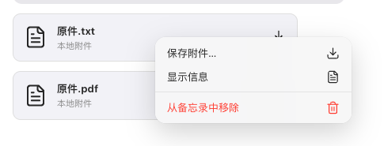

# APP93 导入记录显示与附件菜单

产品实现、定向验证、Mac31 构建及不同代理只读核包均已完成。上一轮 Mac30/Android21 保留，本轮只交付 Mac。

## 使用变化

- 正常图片、录音、PDF 和文件继续导入、显示和保存。应用额外生成的“Apple 备忘录原始记录.json”不再显示为正文卡片或普通附件；此前导入的有效记录也使用相同规则。识别依据是实际记录及归属，普通同名 JSON 不受影响。
- 内部来源记录仍随完整备份和同步保存，数据管理如实统计占用；正常保存笔记不会丢失导入去重信息。
- 右键图片、已保存音频、视频或普通文件，可使用相应的预览/播放、保存附件、显示信息、从备忘录中移除。支持 Shift+F10、方向键、Enter、Esc，移除支持撤销/重做。录制中临时卡的保存文件/移除操作禁用，其他已保存附件仍可用。
- 菜单绑定原笔记和访问状态，切换笔记关闭菜单；保存框期间切换笔记，迟到操作不会导出旧 owner 的附件或影响新笔记。

截图使用合成笔记。完整图、信息面板及明暗菜单见[作者记录](author/README.md)，没有宣称完整原版像素一致。

## 验证

| 层次 | 结果与范围 |
| --- | --- |
| 作者完整产品 Rust | 32 passed / 1 真实来源 ignored；内部记录投影、保存、旧数据和原严格同步规则。见[作者记录](author/README.md) |
| 独立真实 Store | 4 passed；同名普通 JSON、伪造/损坏记录、非法输入、两个 Store 严格 wire、重开与重复导入。见[独审 Rust](independent-rust01/README.md) |
| 实际 React/Tiptap → 生产 core/Session/SQLite | 43 项通过 / 41.921 秒；PNG/WAV/TXT/PDF 公开节点保留和原字节导出，内部记录不显示、备份恢复和去重、菜单及媒体控制器。无 renderer exception，前后源哈希不变。见[作者 DOM07](author/dom07/result.json) |
| 独立菜单 DOM | 6/6 / 14.091 秒含清理；四类真实右键、真实新笔记选文件后移除/Undo/Redo、键盘与信息、四角及无坐标回退、owner 切换、迟到保存拒绝。见[独审 DOM](independent-dom/README.md) |
| 独立窄审作者扩展 | 6 个受管文件在备份与实际 Store 中完整字节相等，PNG/WAV/TXT/PDF 导出逐字节相等；Undo 所有原节点/属性保持，仅允许既有 TrailingNode 追加标准空段落。见[窄审](independent-author-evidence01/README.md) |
| 前端与生产入口 | typecheck、Vite、生产调试 API/URL 排除均自然 0，产品与批准主线逐字节一致。见[最终源身份](author/final-validation.json) |
| Mac31 | 构建自然 0 / 133.829 秒，动态 341 个产品输入在构建前后及打包后相同；最终派生包显式 entitlement、strict 验签 0。见[构建结果](mac-build/result.json) |
| 独立核包 | 自然 0 / 18.862 秒；341 输入、ZIP 完整字节/权限、两份完整嵌入资源/JXA、签名外 Mach-O 字节、实际 Info/entitlement 和派生 strict 0。见[最终独审](final-independent/README.md) |

所有首次失败及后续修复结果保留，包括 lean 测试入口选择、测试前提/目标目录、缺坐标事件、真实 Undo 历史合并以及原生 overlay 阻止调试导航。没有用最终通过覆写原失败。作者和独审分工、来源及具体边界分别记账。

## 包身份

[备忘录-Mac31.zip](../../../artifacts/attachments93/备忘录-Mac31.zip)，7,047,765 字节，SHA-256：`cb367e01d7508947b66da1f41ba44553006eeb865d43cd1e1160befcbf2bb856`。

批准产品主线为 `1cc8deaea4335bffb87b32ddcba4421b5bded971`，实际构建入口为 `a35a72bd2e09ff708d3d77b48f9e31a26158fba4`，后续改动为验证证据/文档，完整产品路径及字节相同。原 linker 签名 strict 1 和缺少 entitlement 的事实保留；只对派生交付包显式使用源 Entitlements 重签，派生严格检查 0。是本地 ARM64 ad-hoc 包，未公证。

## 范围

本轮全部新增验证使用隔离合成数据，来源、原生对话框及媒体设备为模拟边界。未再次读取真实 Apple Notes、用户数据库或麦克风，未操作任何 Android 设备或旧 AVD。菜单接线和文件字节验证不代替原生系统编解码、每台 Mac 的 TCC 授权、真实 Notes 全类型附件导出或完整原版像素验收。APP92 实际来源导出的既有 -10000 失败及范围见[上一轮交付](../apple-notes-import92/DELIVERY.md)。
