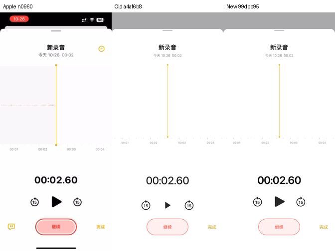

# 手机录音播放与计时59：作者证据

准确源`99dbb95ed0d4f796a71fcb40d5179ed6d90eeaa6`，base `a4af6b8f7f05f59b997e5df3abda25f9521aeec8`。仅改变手机录音View的播放行、中央播放/暂停图形、计时与必要错误排布。实际共享`RecordingView`投影与action sink接受可用状态，不创建媒体、不调用原生、不伪造播放成功。**用户明确暂缓手机设备验收，原Android现场未操作、备份、安装、停止或重启；麦克风、音频与保存数据均未触碰。**

## 原／旧／新实际图像

原为已跟踪有损视频n0960、224×480。旧／新在相同Chrome、392×840逻辑尺寸、DPR2输出784×1680；整张严格等比例LANCZOS降至224×480。没有裁掉系统区再拉伸，没有拟合或遮罩；三方图各列224×480，上方另加25像素说明条。原视频DPR未知，只比较粗几何，不支持高清字体／材质像素PASS。

[原帧拷贝](comparison/reference-224x480.png)、[旧投影](comparison/old-224x480.png)、[新投影](comparison/new-224x480.png)、[命名ROI](comparison/rois.png)、[新叠图](comparison/new-overlay.png)、[旧叠图](comparison/old-overlay.png)、[新差异图](comparison/new-diff.png)、[旧差异图](comparison/old-diff.png)均保存。50%叠图没有增强，差异图为原始逐通道绝对差。

日期为受控当前日10:26，用来保持同文本比较；产品日期仍由真实投影字段格式化。samples为空，未伪造原帧的静音红线。真实源波形、系统状态栏/Home、未知省略菜单、排除的转写、sheet底色、黄色游标下端等残差全部保留，未进入本次修改范围。

## 选择与几何结果

播放行从sheet的75.4%改73.8%，保持8%行高、横向布局及44×44逻辑px触达区域；只将中央手机图形改为局部SVG，左右skip尺寸不变。图形外框39×40逻辑px，含1px光学校准，实际可见墨迹比外框小，验证使用图像墨迹而非把SVG外框当图形尺寸。中央暂停图形仅在真实`playing`投影显示；disabled条件、action和可用性判断没有改动。

计时先实测黑色600/650/700候选，保持既有字号。阈值`max(R,G,B)<96`时，原计时深色像素473，旧灰500为370，黑600/650/700为506/560/598；600最接近。600候选墨迹宽87视频px，650/700更宽；最终600加手机限定`letter-spacing:-1.25px`，宽86，并由65.4%上移到65.2%。最终深色像素509，仍比原重36像素；没有称字体完全复原。深色使用现有`--ink`，不画黑色不可读计时。

下表全部为224×480下**半开**墨迹包络，阈值`maxRGB<96`，与规格59的闭区间换算相差右／下端1。原压缩边缘仍约±1–2视频px不确定。阈值160的第二组结果、像素数与ROI均在[metrics.json](comparison/metrics.json)，测量脚本为[analyze.py](analyze.py)。

| 元素 | 原 | 旧58 | 新59 | 已知改善与残差 |
| --- | --- | --- | --- | --- |
| 大计时 | `[70,330,155,344]` | `[70,331,154,346]` | `[69,330,155,345]` | 宽84→86接近原85，顶缘对齐；左与底仍1px差 |
| 后退15 | `[61,373,78,390]` | `[60,378,77,397]` | `[60,371,77,390]` | 垂直中心偏低6→偏高1px；上缘仍高2px，横向1px差未扩改 |
| 播放三角 | `[104,370,123,392]` | `[108,382,117,394]` | `[104,370,123,391]` | 宽9→19匹配原19，高12→21接近原22；底仍1px差，形状非逐像素相同 |
| 前进15 | `[147,373,163,390]` | `[147,378,164,397]` | `[147,371,164,390]` | 中心偏低6→偏高1px；上缘仍2px、右缘1px残差 |

这些残差保留，未放大整行skip或移动整个sheet去追单一图形。没有为对齐改变58的100px/s、quarter ticks、波形或seek规则。

## 命名区域误差

平均绝对通道误差MAE为0–255；变化比例为该ROI内任一通道误差>16的像素比例。另记录所有非零差比例。全图不遮罩，动态与排除项仍计算在内，指标是描述值，不能由下降判整个手机像素通过。

| ROI | MAE旧→新 | >16变化比例旧→新 |
| --- | --- | --- |
| 计时 | 31.4435→25.4426 | 29.963%→27.912% |
| 播放行 | 31.0691→12.9422 | 21.250%→16.458% |
| 中央播放图形 | 70.3146→19.5533 | 38.159%→32.997% |
| 未改时间轴 | 3.8910→3.8910 | 2.619%→2.619% |
| 完整224×480 | 15.2154→14.3348 | 13.011%→12.766% |

## 窄屏错误排布：必要工程修正

只上移播放行时，320×568下长错误提示框`[x16,y414.59,w288,h21.16]`与新播放按钮`y429.41..473.41`重叠6.34逻辑px，见[new-attempt02](new-attempt02/)。将提示上移至69.7%又会与大计时`y383.92..419.92`相交，因此没有采用。原重试按钮已位于波形与计时之间的共同空带，不能再垂直叠两行44px控件。

最终手机提示移至56%；有重试时提示左12px、宽度最多`100%-100px`、高度最多44px可滚动；重试保留top56%、44px高，右12px、64px宽。无重试的错误／忙碌提示仍最多4%高度可滚动。通过仅手机且`canRetryPreview`时添加的notice class实现，没有新增旧Android WebView不支持的`:has`，没有移动或遮住实际波形seek区域。

| 尺寸 | 波形底部 | 提示框 | 重试框 | 计时顶部 |
| --- | --- | --- | --- | --- |
| 320×568 | 318.31 | `[12,335.25,220,34]` | `[244,335.25,64,44]` | 383.92 |
| 280×600 | 336.25 | `[12,354.14,180,34]` | `[204,354.14,64,44]` | 405.55 |

此表框为`[x,y,width,height]`逻辑值，不是原版测量。两框互不相交，位于波形底部和计时顶部之间；重试、skip、完成的实际点击和原action均通过。长提示仍可滚动，不缩小触达。错误态原视频未证，不冒称原版布局。

## 准确检查及桌面不变

- [最终检查](final/result.json)、[执行](final/execution.json)为PASS：初始、采集中、暂停、播放中、play pending、错误、保存忙碌七态；实际触摸按下播放行三个按钮，核既有`skip(-15)/playback/skip(15)`，disabled不发动作，playing显示暂停。280/320窄宽与dark保持图形在44px触达框内，按钮互不相交；长错误notice/retry不触波形或计时，retry/skip/finish可达；忙碌三个按钮不发动作。受控action sink仅证View派发，不证明媒体播放／保存完成。
- 桌面普通280×467与深色播放中320×600，最终PNG文件字节、DOM字节、全部元素的全部计算样式以及所测几何／按钮hit数据均与Git原源基线一致。旧源按a4af6b8的View/CSS直接加载，不编辑旧树。准确PNG SHA及相等结果见[metrics](comparison/metrics.json)、基线[baseline-computed](baseline-computed/result.json)。
- [最终产品build](build-final/execution.json)PASS，TypeScript+Vite，保留既有大chunk提示。没有无影响的旧完整矩阵、Rust、owner或设备检查。
- [manifest](manifest.json)列出准确三个源文件SHA，确认waveform、Session、coordinator、Dock、Panel、transport、App和style.css与base逐字节一致。

## 首次失败与中间记录

所有输出保留，不覆盖或改标PASS。

- `baseline-preflight`：新检查最初括号语法错误，未到产品；原stderr与exit1保留。
- `baseline-attempt02`：任何产品修改前保存旧源全部基线与600/650/700候选，PASS。
- `new-attempt01`：手机初版动作／hit已过；桌面普通PNG/DOM完全相同，dark DOM/布局相同但PNG9个像素有最多1通道值差，严格PNG字节断言失败。原图与错误保留；差异坐标/数值及原始diff见metrics和[first-desktop-dark-diff.png](comparison/first-desktop-dark-diff.png)，没有以mask掩盖。
- `new-attempt02`：补窄高长错误文案后真实发现提示与新播放触控区域重叠，原失败保留。
- `new-attempt03`：手机错误分列、动作／hit／不相交检查通过；同一dark桌面9像素栅格差仍触发严格断言。没有为消差改变桌面产品。
- 为区分产品回归与栅格残差，补存`baseline-computed`全部计算样式并在检查中逐项比较；PNG相等单独记录，若不同结果必须保持`VIEW_PASS_DESKTOP_RASTER_OPEN`，不吞掉差异。最终`final`两张桌面PNG恰好均逐字节相同，DOM与全部computed也一致，结果为PASS。这个最终结果不抹掉首轮的栅格不确定性。
- `build`为图形最终宽度前通过的中间构建；`build-final`为冻结准确产品源构建。`analysis-run`为最终Pillow度量，使用已有依赖，没有下载。

本轮结论为手机局部可见几何改善、有限View动作可用与桌面未变；整机、真实录音／回放／保存、高清原生材质和完整像素目标仍开放。后续准确包由root独立构建，本次不追认手机设备验收。
