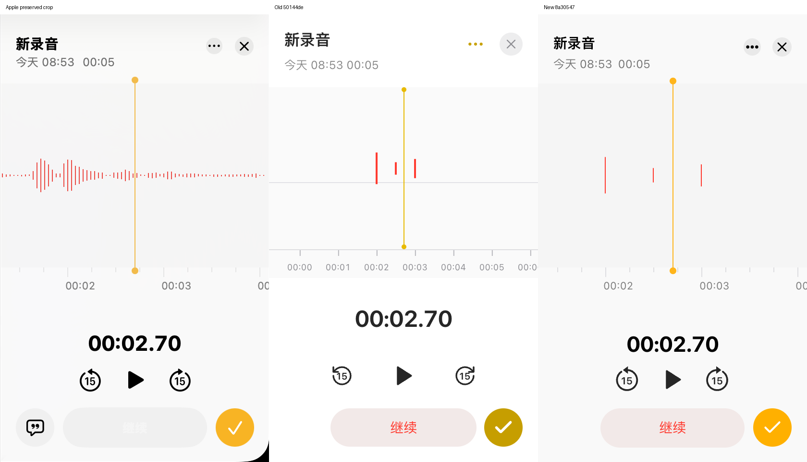
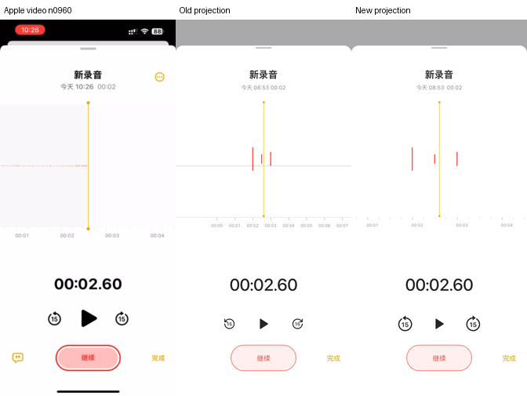

# 录音可见几何58：作者受控证据

准确源：`8a30547514588d1ba6f35eb3c9d2564eb1ee637d`，基线`50144def5e99e2eb2df20f90dd8aa60596d92769`。本证据只覆盖实际共享`RecordingView`在本机Chrome中的投影、受影响Panel/Session及Presentation受控路径。未构建新Mac/Android包，未操作GUI、设备、麦克风、权限、TCC或用户音频。**手机设备验收按用户明确要求暂缓，原Android现场未动；没有备份或导出旧13秒File。**

## 三方图与来源边界

- 原图：已跟踪`references/desktop/recording-20261105/user-recording-sidebar.png`，2672×1246；精确裁剪`[1999,164,560,934]`，没有缩放或拟合。
- 浏览器：真实共享视图280×467逻辑尺寸、明确DPR2，得到560×934像素。只是工程对照边界，**不证明原图DPR**。三方概览每列原尺寸，上方另加30像素说明条。
- [旧图](baseline-clean/desktop-paused-280x467.png)来自Git中50144de的三个原始视图文件，经同一专用fixture加载；[最早基线](baseline/)在任何产品修改前已保存。第二次基线去除测试留下的焦点环，未改写最早输出。
- [新图](final-source/desktop-paused-280x467.png)、[原裁剪](comparison/desktop-reference-crop.png)、[新叠图](comparison/desktop-overlay-new.png)、[旧叠图](comparison/desktop-overlay-old.png)、[新差异图](comparison/desktop-diff-new.png)、[旧差异图](comparison/desktop-diff-old.png)、[命名ROI](comparison/desktop-rois.png)。叠图各占50%；差异图为逐通道绝对差，没有增强或遮罩。
- fixture只传三个明确的受控幅值点（2s/20、2.5s/8、3s/12）给真实View，不冒充原音频或真实采集。产品仍只画传入样本，没有新增静音假样本。日期来自当前日08:53的受控投影；产品仍按真实会话日期格式化。
- 原图灰Continue的精确原因不能由一张图证明。主要三方使用普通paused、可用Continue，保留红色与原图灰色的真实差异；[单独不可继续投影](final-source/desktop-pending-280x467.png)仅展示`canToggle=false`时的灰胶囊，不改变状态机，也不把它计作同态通过。
- 原图转写功能按用户排除，保留左下布局空间；没有伪造可点图形。原生材料、底角、完整字形、动态音频波形、日期间距和图标残差均仍存在，不宣称像素完全相同。

另按根任务要求，复用冻结脚本现有`mount`能力保存[paused + playing对照](comparison/desktop-preview-playing.png)：只有证据副本将该次投影设为`playing=true, canToggle=false`，因此显示真实播放中暂停图形与灰Continue。[证据运行器](capture-preview.mjs)、[生成副本](preview-playing/generated-check.mjs)、[执行](preview-playing/execution.json)全部保留，产品源与固定检查没有变化。原图仍显示播放三角，真实preview状态未知，不能把这张不同态截图计为同态通过；主要指标仍使用普通paused红Continue。

## 可证明的几何变化

以下坐标为裁剪后的**图像像素**。除DOM注明项外，墨迹使用相同阈值自动测量；完整阈值与区域见[分析脚本](comparison/analyze.py)和[原始指标](comparison/metrics.json)。转换为逻辑值须除2。

| 项目 | 原 | 旧 | 新 | 结论 |
| --- | --- | --- | --- | --- |
| 相邻整秒刻度距离 | 200 | 80 | 200 | 由40改100逻辑px/s；绘制与seek共用尺度 |
| 四分之一秒刻度距离 | 50 | 无 | 50 | 主刻度与小刻度都随真实时间偏移 |
| 标题墨迹bounds | `[34,47,120,75]` | `[33,38,126,67]` | `[33,46,117,73]` | y与字宽接近；仍有字体/粗细差异 |
| 大计时墨迹bounds | `[185,670,376,703]` | `[181,618,380,652]` | `[186,672,375,705]` | 顶缘误差52→2图像px，右缘误差4→1 |
| 中央播放墨迹bounds | `[267,745,299,781]` | `[266,735,297,773]` | `[266,743,297,781]` | 纵向接近；三角形状仍不同 |
| 黄色游标bounds | `[274,131,288,541]` | `[276,152,286,490]` | `[274,132,288,542]` | 上下端均剩约1图像px误差 |
| 红波形垂直中轴，逻辑px | 约168 | 160.5 | 167.75 | 来自参考测量及实际samples DOM中点；不比较幅值形状 |
| 完成金色圆bounds | `[449,822,529,902]` | `[448,822,528,902]` | `[448,822,528,902]` | 位置已近，主要修正色相与勾粗细；仍左1图像px |
| 底部胶囊，逻辑DOM frame | 原轮廓约`[65.5,410.5,215.5,451.5]` | `[64,411,216,451]` | `[65,410.5,215,451.5]` | 外轮廓接近；红可用与原灰状态分开 |

标题/日期保持真实值。顶端省略由受全局min-width35影响的透明金点改为18逻辑px灰圆黑点；关闭为20逻辑px圆，未错误统一成18。播放按钮逻辑中心由76/140/204改93/140/187，仍共用中轴。灰粗横线来自`style.css`全局`.waveform`的49.7%–50.3%渐变；现在只在录音作用域清除`background-image`，含dark，不修改通用样式。

## 图像差异指标及限制

绝对通道误差MAE为0–255。变化比例以任一通道误差>16的像素计，分母是该ROI全部像素；另有任何非零差比例保存在JSON。没有动态内容遮罩，也没有用几何数字替代图像。

| 桌面ROI | MAE旧→新 | 变化像素比例旧→新 |
| --- | --- | --- |
| 完整560×934 | 12.659→4.647 | 6.724%→3.976% |
| 时间轴 | 9.260→1.033 | 7.042%→2.252% |
| 大计时 | 52.714→20.203 | 22.045%→12.942% |
| 播放行 | 39.720→23.238 | 20.327%→19.071% |
| 顶部圆控件 | 16.747→8.095 | 18.640%→5.965% |
| 完成圆 | 24.759→11.496 | 56.306%→56.142% |

这些是描述性误差，不是像素验收阈值。完整图和波形ROI的改善部分来自大面积底色趋近；原图真实密集波形与三个fixture样本完全不同。Continue红/灰、被排除的转写、字体、原生渐变及底角仍计入完整图误差，不以数值下降宣称完全一致。

手机原为224×480有损n0960；受控共享sheet用392×840逻辑、DPR2得784×1680，再按**原比例**LANCZOS缩至224×480。时间轴100px/s在此宽度成为57.14视频像素/s，参考约57.5，误差约0.36视频像素/s；常用390宽为57.44（以224/390对比），不是对不同宽度强制同比缩放。手机只核时间轴比例与粗色，未改既有sheet分区位置。[完整手机指标](comparison/metrics.json)保留系统状态栏/Home、顶部省略与被排除的转写差异；当前播放三角尺寸、字重和播放行位置仍明显不等原视频，**不是手机像素通过**。

## 检查结果

| 检查 | 结果 | 证据 |
| --- | --- | --- |
| 实际共享View | PASS | [final-source/result.json](final-source/result.json)、[execution](final-source/execution.json)：点按可见00:03必须请求3000ms；鼠标点按/拖动、Home/End/Arrow、真实touch；投影不预测seek成功；100px刻度/无灰渐变含dark |
| 受影响真实Panel/Session/PM录音widget | 12组PASS | [panel-session-final/result.json](panel-session-final/result.json)、[execution](panel-session-final/execution.json)。旧指针测试动作改为100/200px，保留原1s→2s目标、首个媒体确认后才提交队列第二seek、显示等待确认；拖动离开面板仍由真实pointercapture处理 |
| 真实浮窗/右栏View、Window、Dock、Panel、Session、Owner | 8组PASS | [presentation/result.json](presentation/result.json)、[execution](presentation/execution.json)。共享视图切换/媒体对象/实际媒体确认及保存File契约未退化；均为受控IPC和媒体，非原生窗口验收 |
| 产品TypeScript+Vite build | PASS | [build/stdout.log](build/stdout.log)、[execution](build/execution.json)。保留原有大chunk提示；无Rust/native变化，不重复Rust或原App38组 |

视图截图覆盖280×467、320×467错误+重试、280×360初始/保存忙碌、320×600深色及手机；关键信息与控件仍在可视区域。小高时波形缩短吸收高度，完成/主动作、计时与播放保留位置，重试单独缩短波形。错误与忙碌是工程外观，参考没有相应原态，不写原版像素结论。

[manifest.json](manifest.json)列出准确五个源文件SHA256与原图SHA；Session、coordinator、Dock、Panel、transport、App相对50144de逐字节相同。没有owner、权限、持久化、音频、保存ACK变更。

## 保留的首次及中间执行

- `baseline/`：产品修改前最早PASS；`baseline-clean/`：Git原源渲染、去测试焦点环PASS，主要比较使用后者。
- `preflight-attempt01/`：第一版几何PASS，尚未最终图标细化；`final/`：图标细化后PASS，但手机截图残留先前测试焦点环，故不用于主要像素比较。
- `final-clean/`：失败。作者误将其与Presentation浏览器同时运行，Vite WebSocket24678端口冲突导致`WebSocket closed without opened`；原始stderr/result/execution保留。随后恢复严格串行，`final-serial/`PASS；增加独立00:03刻度断言后`final-source/`PASS，是最终视图证据。
- `panel-session/`：12组PASS的初版同物理距离0.4→0.8s检查保留；最终按原语义1→2秒修改手势后`panel-session-final/`12组PASS，不用前版代替最终。
- 图像分析最早直接执行失败于缺少numpy；`comparison-preflight/`保留相同缺依赖原错误。没有安装任何依赖，分析改用已有Pillow；`comparison-run/`PASS；修正标签墨迹阈值和旧标题搜索范围后`comparison-final/`PASS，输出最终JSON和图。中间脚本仅生成证据，不改产品。

本次未达到完整Apple Notes像素一致。准确新包、WebKit字形/原生材料、Mac实际界面以及用户暂缓的手机设备验收仍由后续工作单独负责，不能从受控Chrome截图推导麦克风、可听音轨或真实设备通过。
