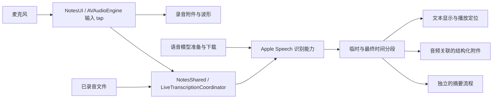

# macOS 备忘录录音、转写实现与跨平台可行性

调研日期：2026-11-08（Asia/Shanghai）。目标：`/System/Applications/Notes.app`。方法：REA 6.7.0 静态检查、Apple 系统工具读取 dyld shared cache 与 ARM64 汇编、官方资料交叉验证。

后续重点调查已完成：[Notes 实际接口与自有应用调用实验](../2026-11-08-notes-speech-api-probe/README.md)。进一步确认本机普通录音转写路径直接调用内部 `Transcriber + SpeechAnalyzer SPI`，并通过独立程序验证公开 `SpeechTranscriber + SpeechAnalyzer` 可以完成文件与实时 PCM 转写。下文保留第一轮证据边界；实际接口归属以补充报告为准。

## 结论

**录音与边录边转文字的功能可以在 Android、Windows 重做；Apple Notes 的二进制、私有框架和系统语音模型没有可直接移植的跨平台接口。** 可以复用的是采集、流式识别、带时间的分段、附件保存和播放定位的设计。

当前样本的录音链路使用 Apple 原生音频栈。`NotesUI` 不只是引用了 `AVAudioEngine`：汇编中确实存在取得 `inputNode`、安装录音 tap、启动引擎的调用。转写由 `NotesShared` 的实时协调器和语音识别管理器负责，包含模型下载、音频 buffer 输入、临时/最终分段和附件持久化接口。

Apple 在 WWDC25 明确说明新的 `SpeechAnalyzer` / `SpeechTranscriber` 用于 Notes、Voice Memos、Journal，并在设备上运行。**本机内部符号是 `Speech.Transcriber.MultisegmentResult`、`SiriSpeechRecognitionManager` 等，不能把内部名字等同于第三方可调用的公开 API。** 对自己的 macOS 应用，优先通过公开 Speech API 实现。

对当前 CyberNote，建议先做“已保存录音 → 本地转写 → 时间分段 → 点击文本定位播放”，以独立识别后端支持各平台；稳定后再接实时采集。若以 Android、Windows 一致性和离线可控为目标，优先验证共享的开源本地引擎；系统识别作为可选后端。

## 目标身份与检查边界

| 项目 | 本次样本 |
| --- | --- |
| 系统 | macOS 26.4，build `25E246` |
| Notes | `4.13`，build `3146.101.28` |
| Bundle ID | `com.apple.Notes` |
| 可执行文件 | `/System/Applications/Notes.app/Contents/MacOS/Notes` |
| 完整 universal 文件 SHA-256 | `9e20c23a979367362c50edf8fb28bb1988be7e7384254cc3dce38a4a8373df02` |
| 检查切片 | `arm64e`；REA open 返回 CPU family `arm64` |
| 主程序切片 UUID | `A70FB33C-2D3D-3E23-B778-E3B55E41581A` |
| NotesUI cache image UUID | `7A4266DE-A24F-388E-B4AD-99BEFA304496` |
| NotesShared cache image UUID | `60574B35-C9EE-3661-A504-63318659307C` |

这是对当前安装版本的检查，不自动代表 macOS 15 或 iOS 18 时代的实现。通话录音和普通麦克风录音是不同入口；本次以普通录音为主，通话相关符号仅作为附带观察。

本次没有启动/重启 Notes，没有读取个人备忘录数据库、录制麦克风、提交语音反馈或更改系统设置。没有完成断网转写、识别质量、耗电、长录音或 Android/Windows 实机测试。因此，“设备端模型”有 Apple 官方资料支持，但不是本机断网实验的结论。

REA 的 Mach-O、签名、plist 检查可用；深度函数 provider 不可用：Hopper 未安装、Ghidra 未配置、IDA/Kuna 未配置。没有为此安装或重配工具。函数级补充证据来自现有 Apple `dyld_info` 的反汇编，**不是 REA 反编译得到的源码**。

## 问题与证据状态

| 问题 | 状态 | 结论与证据边界 |
| --- | --- | --- |
| 如何采集录音？ | 已回答到框架和调用层 | NotesUI 导入 AVAudioEngine，汇编有 inputNode / installTap / start 调用；具体硬件采样率和输出编码未确定 |
| 如何边录边转写？ | 已回答到模块/API 层 | LiveTranscriptionCoordinator、receiveAudio、临时/最终分段、Speech.Transcriber 类型；未恢复全部异步调用图 |
| 是否使用 Apple 自有模型、在何处运行？ | 官方说明与本机接口交叉支持 | 官方介绍设备端新模型；本机有 ASR 模型下载接口；没有恢复权重、网络结构或推理内核 |
| 转写如何与播放关联、保存？ | 已回答到数据模型/API 层 | 文本、起点、时长、说话人、片段 UUID，以及保存至子附件的调用；未解码个人数据库或全部序列化格式 |
| 是否等同于 Apple Intelligence 摘要？ | 已区分 | 转写和摘要有独立接口，摘要有额外 Apple Intelligence 条件 |
| 能否移植 Android/Windows？ | 已完成技术可行性评估 | Apple 实现不能直接跨系统调用；可替换采集和识别后端后复现功能；尚无跨平台性能验收 |

## 观察到的实现

### 1. 主程序负责组装，核心逻辑在系统框架

REA Mach-O 记录了 107 项依赖，包括：

- `NotesEditor.framework`：录音、转写、摘要相关编辑界面。
- `NotesUI.framework`：录音控制器与 `AudioRecordingManager`。
- `NotesShared.framework`：转写协调、语音管理、音频/文本附件模型。
- `NotesSupport.framework`：功能和模型可用性相关支持。
- `AVFAudio.framework`、`Speech.framework`：音频与语音能力。

主程序导入 `ICAudioRecordingManager`、`ICAudioRecordingViewController`、`ICBackgroundTranscriptionHelper`、`Transcription.shared` 等符号。依赖和导入是直接静态事实；它们本身不证明某次用户操作实际运行了对应分支。[R1、S1]

这些私有框架在本机没有独立的可读 Mach-O 文件；Apple `dyld_info` 能按 install name 从系统 dyld shared cache 读取。框架证据以 cache image UUID、命令输出 SHA-256 和工具身份绑定，不能冒称对独立框架文件计算了 SHA-256。[S2]

### 2. 录音：AVAudioEngine 输入 tap，而非只靠 AVAudioRecorder 猜测

`NotesUI.AudioRecordingManager` 的初始化接口接收 `LiveTranscriptionCoordinator` 和 `ICAttachmentAudioModel`，同时暴露录音状态、累计时间、开始时间和波形 samples。框架导入 `AVAudioEngine`、`AVAudioFile`、`AVAudioConverter`、`AVAudioPCMBuffer`。[S2]

更强的证据是实际 ARM64 指令中的调用点：[S3]

| cache 虚拟地址 | 静态调用 |
| --- | --- |
| `0x1D95675E4` | `objc_msgSend$inputNode` |
| `0x1D9567720` | `objc_msgSend$installTapOnBus:bufferSize:format:block:` |
| `0x1D9567744` | `objc_msgSend$prepare` |
| `0x1D9567900` | `objc_msgSend$startAndReturnError:` |
| `0x1D9568774` | `objc_msgSend$removeTapOnBus:` |

结合导入和代码邻近关系，可判断录音使用音频引擎输入 tap 取得 buffer。音频转换调用也存在。**本次未完整追踪 tap block 内的所有间接调用，因此“同一采样流分别进入文件、波形和转写”是接口组合支持的高可信架构推断，而非已恢复的完整数据流。**

未证实 Notes 使用何种采样率、声道、比特率和最终录音编码。`NotesShared` 有 M4A 导出相关导入，不能据此确定所有普通录音都以该格式采集或存储。

### 3. 转写：流式协调、模型准备和后台任务

`NotesShared` 中观察到的接口包括：[S2]

```text
LiveTranscriptionCoordinator(attachmentModel:)
  receiveAudio(AudioData) async throws
  transcribe(file: URL?) async throws
  finishTranscription() async throws
  tempSegments / finalizedSegments / fetchedSegments
  transcript / rawTranscript / transcriptSegments

SiriSpeechRecognitionManager
  setUpAudioTask() async throws -> AsyncStream<Speech.Transcriber.MultisegmentResult>
  appendAudioBuffer(buffer: AVAudioPCMBuffer) throws
  finish() async throws
  downloadASRModel(NGASR:progress:)
  asrModelNeedsDownload(NGASR:)

Transcription
  addAudioTranscriptionTaskToQueue(attachmentIdentifier:)
  addCallRecordingTranscriptionTaskToQueue(speakers:attachmentIdentifier:)
```

上述为从 Swift mangled symbol 解读的接口摘要，省略派发 thunk 和元数据变体，不是 Apple 源码签名的逐字恢复。关键方法拼写另经 `swift-demangle` 核对，见 [demangled-features.json](evidence/demangled-features.json)。

模型管理还有实际调用 `fetchAssetWithConfig:clientIdentifier:progress:completion:` 的汇编证据，说明至少存在资源准备/下载机制。[S3] 这不等于每次识别都上传音频，也不说明 `NGASR` 开关在本机普通录音流程中一定取哪个值。

Apple [WWDC25 session 277](https://developer.apple.com/videos/play/wwdc2025/277/) 说明 `SpeechAnalyzer` 管理分析会话，`SpeechTranscriber` 提供适合长音频、会话的设备端新模型，支持实时麦克风输入和已录文件；Notes 等系统应用采用了这项技术。[P1]

官方还说明模型在应用进程之外运行，语言资源由 `AssetInventory` 下载并交给系统管理。这是操作系统提供的识别能力，不是从 Notes.app 包内取出一个模型文件就能复用；本次没有进行进程追踪来验证本机服务边界。[P1]

因此第三方 macOS 实现应采用公开 API、可用性检查和模型资源管理，不应依赖 `NotesShared` 的内部 `SiriSpeechRecognitionManager`。其中出现 “Siri” 也不能单独证明语音走 Siri 云服务。

### 4. 转写是带时间的结构化附件

`TranscriptViewModelSegment` 包含 `text`、`startTime`、`duration`、`endTime`、可选 `speaker` 等字段；模型有从 `Speech.Transcriber.MultisegmentResult` 转换分段的接口，并区分 temporary 与 finalized 状态。[S2]

`ICTTTranscriptSegment` 也有 `text`、`timestamp`、`duration`、`speaker` 元数据。存在 `ICTTAudioDocument`、录音 fragments 和音频模型的 `saveModelDataToSubattachment(transcriptSegments:fragmentUUID:retranscription:)` 接口。在 `LiveTranscriptionCoordinator` 标签范围内，`0x1D9213D5C` 的汇编调用了该保存接口。[S2、S3]

这支持“转写结果作为录音关联的结构化数据保存，并可按时间定位播放”的设计判断。尚不能据此给出完整的 Apple 数据库 schema、字段单位、冲突合并规则或字级对齐精度；说话人字段存在也不证明普通单麦克风录音具备通用多人分离。

### 5. 转写、摘要与网络行为需要分别理解

签名中观察到音频输入权限、`com.apple.assistant.dictation.prerecorded`、摘要相关 entitlements 和网络权限。代码也有摘要 view model、`generateFinalTopLineSummary`，以及用户反馈使用的 `SpeechDonation` 相关导入。[R2、S1、S2]

这说明 Notes 同时集成多项能力，不足以证明转写依赖摘要模型或必须开启 Apple Intelligence。Apple 的 Notes 26 用户指南将基础音频转写的条件列为 **M1 或更新 Mac、支持的设备语言**，生成摘要另需 Apple Intelligence。支持语言包括英语、若干西欧语言、日语、韩语和简繁中文；实际可用性还应以系统版本和模型语言查询为准。[P2]

“设备端识别”也不能推广成“应用绝不联网”：模型下载、iCloud 同步、用户主动提交准确性反馈是不同网络活动。本次没有抓包，也没有判定它们何时发生。

## 可复现的处理架构

下图是证据支持的模块分工；跨模块箭头为架构归纳，不表示已恢复完整的静态调用图。



## Android 和 Windows 的落地选择

| 层 | 能复用的部分 | 需要替换或验证的部分 |
| --- | --- | --- |
| 录音与波形 | 本项目会话状态、波形、附件保存、播放界面 | Android AudioRecord/MediaRecorder，Windows WASAPI，或逐平台验证现有 WebView 媒体栈 |
| 识别任务 | 文件转写、实时 buffer、取消/重试、模型状态的统一协议 | Apple、Android、Windows 或开源识别后端 |
| 分段与播放 | 时间轴、临时/最终文本、点击跳转、搜索 | 每个后端的时间精度、修订语义、长音频偏移 |
| 数据持久化 | 项目自有 JSON/SQLite/同步模型 | 不能直接依赖 Apple 的内部对象或存档格式 |
| 摘要与说话人 | 可独立扩展 | 不应把 ASR 默认当作摘要或通用说话人分离引擎 |

**Android 系统方案。** `SpeechRecognizer.createOnDeviceSpeechRecognizer()`（API 31+）提供设备端识别入口，但必须先检测可用性；普通 `createSpeechRecognizer()` 可能使用远端服务。`EXTRA_PREFER_OFFLINE` 只是请求，具体实现可忽略。官方还明确指出普通 SpeechRecognizer 不适合持续识别，不能把它直接当作无限长会议转写引擎。不同设备、引擎、语言和离线模型的覆盖不一致；有新版本音频输入、分段会话能力也需要实际 provider 支持。[P3]

**Windows 系统方案。** 老的 `Windows.Media.SpeechRecognition.SpeechRecognizer` 与新版 `Microsoft.Windows.AI.Speech.SpeechRecognitionModel` 要区分。新版支持本地音频文件和实时流；截至本次查阅的官方文档，它仍是 experimental，需要 Windows 11 24H2+、指定的实验版 Windows App SDK，支持 CPU，也可在合适 Copilot+ PC 上使用 NPU；CPU 模型首次需要下载。官方明确不支持用于生产，不能把它作为当前发布版的默认依赖，也不能说它只支持 NPU。[P4]

**共享本地引擎方案。** `whisper.cpp` 或 `sherpa-onnx` 可作为候选，Android 通过 JNI/原生插件、Windows 通过本地库接入，业务协议统一。具体引擎与模型需要分别核查许可证、中文效果、包体、内存与持续速度。Whisper 的分窗实时处理不自动等于稳定的低延迟流式识别；多人说话人分离通常也需要额外模型或流程。[P5]

建议的优先级：

1. Android、Windows 的共同基线：验证一个共享本地 ASR 引擎，先做文件转写；以实测决定模型，不承诺三端与 Apple 同等准确率。
2. macOS 26+：增加公开 `SpeechAnalyzer` / `SpeechTranscriber` 后端，遵守 API 的语言、设备、模型可用性条件。
3. Android on-device：作为检测通过后的可选后端；不可用时明确降级，不静默切云端。
4. Windows AI：保留实验后端，等生产支持与目标设备覆盖明确后再考虑默认启用。

若接受云端识别，可增加统一的服务器适配器，但它涉及音频传输、费用和离线能力变化，应单独作为产品决策。

## 对当前仓库的影响

当前已有录音采集和保存，不需要从零重建录音界面：`src/recording-session.ts` 使用 `getUserMedia`、`MediaRecorder`、`AudioContext`；`src/recording-pcm.ts` 将音频转成 **24 kHz、单声道、PCM16 WAV**。该格式是本项目实现，不是本次发现的 Apple 录音参数。[C1]

本次对 `src/`、`src-tauri/`、`plugins/` 的相关检索未发现已实现的语音转写后端；现有 `docs/ui/recording-desktop.md` 也明确此前录音工作排除听写和转写。项目 README 当前列出的目标平台为 macOS、Android；Windows 还需要独立处理构建、采集、权限和打包，不是只增加一个识别函数就完成支持。[C1]

建议后续实验使用项目自有协议，例如：

```text
TranscriptionJob
  id, logicalRecordingId, audioRevision/hash, language, backend, modelVersion
  state: queued | preparing-model | running | completed | failed | cancelled

TranscriptSegment
  id, startMs, endMs, text, isFinal, optional speaker
```

这是新设计建议，不是 Apple schema。要绑定逻辑录音 ID 与实际音频版本，避免暂停后自动保存出新 revision 时旧任务写回新音频；优先保存 sidecar 结构化转写，用户明确执行时才插入笔记正文。取消和失败不应破坏已保存录音。现有录音有累计 WAV、容量上限等规则，实时识别需要额外的队列背压和时间轴映射。

最低验证集：同一批自制中/英文固定录音，在三端检查文本错误、分段时间、断网可用性、模型缺失、长音频、暂停/继续、取消、重新转写、音频版本变化、内存与实时速度。未通过这些实验前，只能确认技术可行，不能声称产品级体验已移植。

## 证据索引与复现

| 编号 | 证据 | 类型与限制 |
| --- | --- | --- |
| R1 | REA `inspect_macho`，`ev_912626bede73167d3e08ed8ba534a762f2506802b8b387ba165ed8b77fee848a` | 主程序依赖、导入；导入/导出不保证穷尽 |
| R2 | REA `inspect_signature`，`ev_c28487ab1c3614b42f01d44b632b7647d91cbaeda2b804d85b24c932c2a5bec7` | 签名与 entitlements；不是运行时权限使用记录 |
| R3 | REA `inspect_plist`，`ev_e827bc9685a11af3ed743887e5a5cc65528855a2665cd57d4557d8d663c38755` | 版本、Bundle ID、麦克风用途说明 |
| S1 | `notes-dependencies.txt`、`notes-symbols-audio-excerpt.txt`、`notes-strings-audio-excerpt.txt` | Apple CLI 静态输出；strings 不证明执行，包含 universal 文件可见文本 |
| S2 | [NotesUI](evidence/notesui-cache-inspection.txt)、[NotesShared](evidence/notesshared-cache-inspection.txt)、[NotesEditor](evidence/noteseditor-cache-inspection.txt)、[NotesSupport](evidence/notessupport-cache-inspection.txt) | dyld_info：cache image UUID、依赖、导入/导出和 ObjC；符号可见性有界 |
| S3 | `notesui-audio-call-sites.txt`、`notesshared-audio-call-sites.txt`、两份 `*-audio-disassembly.txt` | ARM64 汇编；call-sites 每命中保留前后20行，disassembly 按标签筛选，标签范围可能包含无名代码，不保证完整函数边界 |
| C1 | [当前项目与跨平台来源笔记](sources-portability.md) | 仓库源码检查与候选方案；不是平台运行测试 |
| P1–P5 | [官方资料、API 条件与候选引擎来源](sources-portability.md) | 公开文档证据，与本机样本版本分开解读 |

所有 R 类完整记录保存在 [rea-evidence.json](evidence/rea-evidence.json)。S 类文件、精确 argv、完整输出摘要、摘录筛选规则和保留文件 SHA-256 见 [shell-manifest.json](evidence/shell-manifest.json)；系统、样本、工具身份与 REA provider 限制见 [target-identity.json](evidence/target-identity.json)。REA bundle 中没有登记 unknown 不代表本报告没有未知项；未解决问题以上表和正文为准。

从仓库根目录检查保留证据的完整性：

```sh
python3 labs/2026-11-08-notes-audio-transcription/replay-static.py --verify
```

本次已执行完整性检查，并在新临时目录重放补充静态命令；13 份保留输出与原证据的 SHA-256 全部一致。验证记录见 [verification.json](verification.json)。这验证采集结果可复现，不替代录音/转写运行测试。

在相同 Mac 上，把补充静态命令重放到一个**不存在的新目录**（不启动 Notes）：

```sh
python3 labs/2026-11-08-notes-audio-transcription/replay-static.py --out /tmp/notes-audio-recheck
```

REA 复查顺序：`open_binary('/System/Applications/Notes.app')` → `inspect_macho(detail='summary')` → `inspect_signature()` → `inspect_plist()` → `export_evidence_bundle(新绝对路径)` → `close_binary()`。系统更新后必须先比对 SHA-256 / UUID，不能套用本报告地址。

后续尚待回答的关键问题：本机普通录音实际选择的内部识别分支、精确编码参数、模型资源与内核实现、断网行为、普通多人录音的说话人能力，以及 Android/Windows 的质量和性能。当前证据足以支持架构判断与下一步选型，不支持声称已复刻 Apple 模型或完成跨平台功能。
