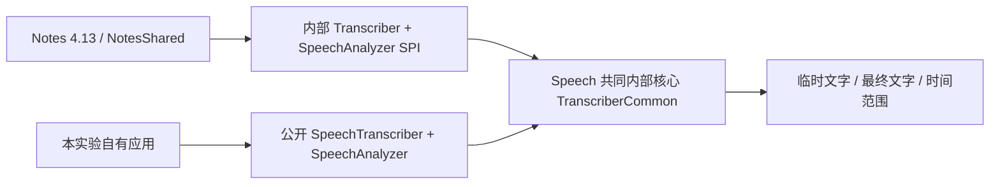

# Notes 4.13 实际转写接口与自有应用调用实验

日期：2026-11-08。目标：回答“Notes 调的是公开 SpeechTranscriber，还是在线实时识别”，并用自己的程序运行公开接口。补充并收紧[第一轮调研](../2026-11-08-notes-audio-transcription/README.md)中尚未确定的调用路径。

后续补充：[公开 API 的系统版本、硬件与运行条件](availability.md)。明确区分 26.0 起的接口可用性、设备模型能力、Notes 产品支持条件和本机实测。

## 明确结论

1. **本次追踪到的 Notes 4.13 普通录音/实时转写代码直接使用内部 `Speech.Transcriber` 和 `SpeechAnalyzer` SPI，并不是直接调用公开 `SpeechTranscriber`。** 这是根据 NotesShared 的实际 ARM64 调用点、系统缓存指针和 Speech 导出的对应关系得出的静态结论，详见[内部路径证据](notes-path.md)。不能把 WWDC 对产品技术的介绍直接等同于该版本的公开类调用名。
2. **“实时”不等于“联网识别”。** Notes 的内部调用配置包含 `liveTranscription`、临时结果和时间信息；公开 `SpeechTranscriber` 采用设备端模型，Apple 文档明确说 SpeechAnalyzer 转写模块不向 Apple 服务器发送语音。本次没有对 Notes 本身做断网测试或抓包，因此不声称逐次排除了 Notes 的所有网络行为。
3. **自己的 macOS 应用能通过公开 API 实现这类本地实时转写，已经实测成功。** 本实验编写了独立 Swift 程序，正常 `.app`、逐块实时 PCM 输入、开启 App Sandbox 的 `.app` 均成功返回中文转写和时间信息，不需要 Notes 的私有权限。

这里“能调用”指受支持的公开 `SpeechTranscriber + SpeechAnalyzer`，不表示第三方获得了 Notes 内部 SPI 的公开调用资格。两条路径都进入 Speech 的共同内部实现，但不能据此保证相同模型、配置、后处理或识别质量。

## 三种名字和三种概念

| 名称/概念 | 本次确认的含义 |
| --- | --- |
| `SpeechTranscriber` | macOS 26+ 的公开转写模块，本实验自己的程序实际调用它 |
| `Speech.Transcriber` | NotesShared 实际调用的内部模块类型，普通 `import Speech` 下无法直接引用 |
| `SpeechAnalyzer` | 同时有公开 API 与内部初始化接口；只看到这个类名不足以判定调用的是哪一层 |
| 实时/流式 | 音频还在输入时就返回临时文字，本地和云端都可以采用这种交互 |
| 设备端推理 | 识别模型在本机处理音频；不等于模型资源永远不需要下载 |
| 在线识别 | 把音频送往服务器识别，不能仅凭 `Siri`、`live`、`stream` 名字判定 |

更准确的关系是：



上图是静态代码与自有应用实验支持的结构归纳，不是对 Notes 进程进行动态注入后记录的调用图。

## Notes 的直接代码证据

在与前轮相同的 macOS 26.4 / Notes 4.13 样本中，进一步解析系统 dyld cache 的 authenticated stub 和指针链，得到以下关键对应关系：

- NotesShared `0x1D9223D50`：调用内部 `Speech.Transcriber.init(locale:taskHint:modelOptions:transcriptionOptions:reportingOptions:attributeOptions:)`。
- NotesShared `0x1D920ADF4`：调用带 `client`、`restrictedLogging` 等内部参数的 `SpeechAnalyzer` 初始化接口，这些参数不属于本次 SDK 的公开初始化签名。
- 实时转写配置引用 `Speech.TaskHint.liveTranscription`，并使用临时结果、多分段结果、时间范围等选项。
- Speech 中公开 `SpeechTranscriber` 和内部 `Transcriber` 的初始化路径都创建 `TranscriberCommon`；这支持“同一 Speech 技术栈的不同入口”，不能推出配置或模型必然相同。

普通公开 SDK 中的 `SpeechTranscriber` 确实存在，而 `Transcriber` 不在普通公开接口内。本实验另外执行了一个预期失败的编译检查：

```swift
import Speech
let internalType = Transcriber.self
```

编译器报 `cannot find 'Transcriber' in scope`。这是“不能按普通公开 API 写法直接调用”的证据，不是“二进制动态调用在技术上绝无可能”的证明。[编译结果](evidence/private-surface-compile.json)

全部缓存解析方法、调用筛选边界、地址、反汇编和 REA 记录见 [notes-path.md](notes-path.md)。静态路径不能代替当前 Notes 会话的实际执行记录；也不排除其他功能、配置或版本存在不同分支。

## 本地还是在线：能证明到哪一步

Apple 的[语音权限文档](https://developer.apple.com/documentation/speech/asking-permission-to-use-speech-recognition)明确区分旧 `SFSpeechRecognizer` 与新系统：

> This process only applies to speech recognition using SFSpeechRecognizer. SpeechAnalyzer transcriber modules don’t send audio data of the user’s voice to Apple’s servers.

本地保留了该页面的 [DocC JSON](evidence/apple-permission-doc.json)，其中名称由文档引用项解析；不能截取页面开头旧接口“发送到服务器”的描述，再套到新接口上。另参见 [SpeechTranscriber](https://developer.apple.com/documentation/speech/speechtranscriber)、[SpeechAnalyzer](https://developer.apple.com/documentation/speech/speechanalyzer) 和 [WWDC25 Session 277](https://developer.apple.com/videos/play/wwdc2025/277/)。

本实验增加了一个仅授予 `com.apple.security.app-sandbox = true` 的自有应用，**没有 `network.client`、麦克风或任何 Notes 私有 entitlement**，依然成功完成转写。它说明应用本身不需要获得外连网络能力来实现这条识别路径。

必须保留的边界：应用沙箱不等于把系统所有 Speech 服务断网。本次没有关闭整机网络、拦截系统服务或做完整流量捕获。因此，设备端识别的判断来自官方明确契约、自有应用测试以及内部路径证据的组合；不是一次完整的 Notes 断网实测。模型资源准备与语音识别也要分开：前者可能联网，后者采用本地模型。

## 测试程序

- [SpeechProbe.swift](SpeechProbe.swift)：只导入公开 `Speech`、`AVFoundation`、`CoreMedia` 和 `Foundation`。
- [build.sh](build.sh)：生成 CLI、具有独立 Bundle ID 的正常 `.app`、以及 App Sandbox `.app`，均使用本机 ad-hoc 签名。
- [run-tests.py](run-tests.py)：执行正反向测试，保存原始 stdout/stderr、进程退出码、源码/二进制/音频 SHA-256 和验证摘要。
- [Sandbox.entitlements](Sandbox.entitlements)：只有 App Sandbox 权限，便于复查。
- [fixtures/zh.wav](fixtures/zh.wav)：17.524625 秒的固定中文合成语音；[原文](fixtures/zh.txt)。音源为系统 `say` 的 Tingting，速率参数 `-r 155`，转换为 24 kHz 单声道 PCM16 WAV；没有使用私人音频。

核心公开调用如下：

```swift
let transcriber = SpeechTranscriber(
    locale: Locale(identifier: "zh-CN"),
    preset: .timeIndexedProgressiveTranscription
)
let modules: [any SpeechModule] = [transcriber]
let analyzer = SpeechAnalyzer(modules: modules)

// 在另一个并发任务中消费，不能等分析结束后才开始读结果。
for try await result in transcriber.results {
    // result.text / result.isFinal / result.range / text.runs.audioTimeRange
}

// 文件路径：框架处理文件输入。
_ = try await analyzer.analyzeSequence(from: audioFile)
try await analyzer.finalizeAndFinishThroughEndOfInput()

// 流式路径则将 PCM 转为框架要求的格式，逐块产生 AnalyzerInput：
// _ = try await analyzer.analyzeSequence(inputSequence)
```

以上为调用关系示意；可运行的并发、资源准备、转换、取消和错误处理以完整源码为准。实时模拟使用 250 ms buffer、最多排队8块，按音频时间喂入；从同一个 PCM 采集源替换文件读取就能接麦克风，但本次没有做真实麦克风权限和硬件采集测试。

程序先检查 `isAvailable`、语言支持和 `AssetInventory.status(forModules:)`。只有显式传入 `--install-model` 才调用资源安装接口；不做云端回退。初次运行发现 `installedLocales` 已含中文，模块状态仍为 `supported`，执行资源准备后才成为 `installed`。不能把语言列表等同于当前模块已可立即运行，也不能把这次准备耗时直接当成实际下载大小的证据。

## 实际结果

环境：Apple M5、32 GiB 内存，macOS 26.4 `25E246`；Swift 6.3.3，SDK 26.5，编译部署目标 macOS 26.0，arm64。以下为同一份合成音频的一次验证结果，不是通用性能基准。

| 用例 | 实测结果 |
| --- | --- |
| 独立正常 `.app` 文件转写 | 成功；Bundle ID 为 `com.local.cybernote.speech-probe`；识别阶段约0.83秒 |
| 按真实时间输入 PCM | 成功；首条临时文字约1.08秒；最终结果约17.64秒，早于结束返回了临时文字 |
| App Sandbox `.app` 文件转写 | 成功；独立 Bundle ID；无外连网络 entitlement；识别阶段约0.25秒，已有热缓存 |
| 时间信息 | 每个正向用例返回70个带音频时间的文本 span；它们不应直接等同于70个自然语言词 |
| 错误语言 `xx-XX` | 明确返回错误，进程退出码1 |
| 不存在的音频文件 | 明确返回错误，未伪报完成 |
| 旧版 Speech 授权 | 全程 `notDetermined`（raw 0），没有调用授权请求；本次仅做文件输入 |
| 私有类型普通编译 | 引用 `Transcriber` 按预期编译失败 |

所有正向用例识别出了“苹果笔记、私人录音、星期五、整理资料、编写程序、检查结果”六项检查内容，但**有真实识别错误**：原文“录音转文字”被识别为“录音拽文字”，标点也不完整。成功标准是 API 可用、返回实际中文与时间数据、流式行为成立，不是宣称识别完全正确。

完整结果见 [validated-run/summary.json](evidence/validated-run/summary.json)，各用例原始事件也在同一目录。`public-imports.json` 保留了最终程序的未定义符号，可核对它调用公开 `SpeechTranscriber`，没有依赖 `NotesShared`。较早的 `public-*.json` 是开发过程中的初次资源检查和试运行；最终判定以 `validated-run/` 和其中绑定的源码 SHA-256 为准。

## 在自己的 Mac 上复现

要求：Apple Silicon、macOS 26+、包含新 Speech API 的 Swift 工具链。是否支持某种语言仍需实际查询；不能根据本机成功推断所有 Mac 都支持。以下命令从仓库根目录执行。

```sh
sh labs/2026-11-08-notes-speech-api-probe/build.sh

# 查看语言与当前资源状态，不下载模型。
labs/2026-11-08-notes-speech-api-probe/.build/SpeechProbe --locale zh-CN

# 已保存音频转写。首次必要时允许系统准备/下载对应资源。
labs/2026-11-08-notes-speech-api-probe/.build/SpeechProbe \
  --locale zh-CN \
  --file labs/2026-11-08-notes-speech-api-probe/fixtures/zh.wav \
  --install-model

# 模拟实时音频输入；结果以 JSON Lines 持续输出。
labs/2026-11-08-notes-speech-api-probe/.build/SpeechProbe \
  --locale zh-CN \
  --file labs/2026-11-08-notes-speech-api-probe/fixtures/zh.wav \
  --stream --pace --install-model

# 用独立沙箱应用的 Bundle ID 和权限运行内置音频。
labs/2026-11-08-notes-speech-api-probe/.build/SpeechProbeSandbox.app/Contents/MacOS/SpeechProbe \
  --locale zh-CN --bundled-fixture --install-model

# 全套验证，输出路径必须是一个不存在的新目录。
python3 labs/2026-11-08-notes-speech-api-probe/run-tests.py \
  --prepare-model --out /tmp/notes-speech-probe-run
```

CLI 和 `.app` 都是无图形界面的实验宿主，从终端运行可查看 JSON 输出。`.build/` 不纳入版本控制，按源码重新构建即可。对于沙箱应用的任意外部文件，正式产品仍需正常的文件选择授权；本例用 bundle 内置的非私有测试音频验证，不绕过文件权限。

## 对 CyberNote 的实现建议

macOS 26+ 可直接使用本实验已跑通的公开 API，在 Tauri 原生边界增加 Swift 识别适配层。保持单一采集源，将 PCM 同时分发给录音保存和识别；先用 `bestAvailableAudioFormat` 查询，再做格式转换。本机识别模块选出的格式为16 kHz单声道，项目现有24 kHz WAV不能未经处理直接假定兼容。

业务层需处理临时文字的替换、最终文本提交、音频版本绑定、取消、模型准备失败和时间轴。不要把每条临时结果都追加成永久正文。使用模型原生的时间 span，明确其粒度；把转写和可选摘要分成两项能力。

这次已经验证“自己的 Mac 应用可以调用公开接口”，尚未把识别器接进 CyberNote 主程序；也未验证真实麦克风、长时间录音、后台切换、Intel Mac、Android 或 Windows。Apple 公开接口仅适用于相应 Apple 平台，跨平台仍需其他识别后端。
